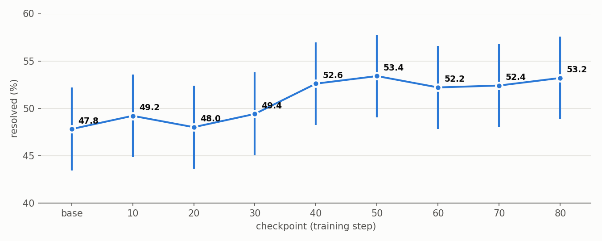
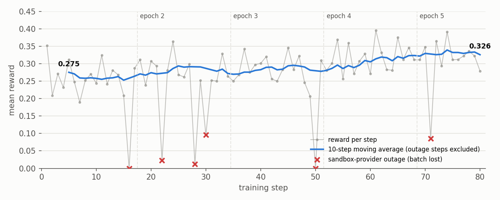
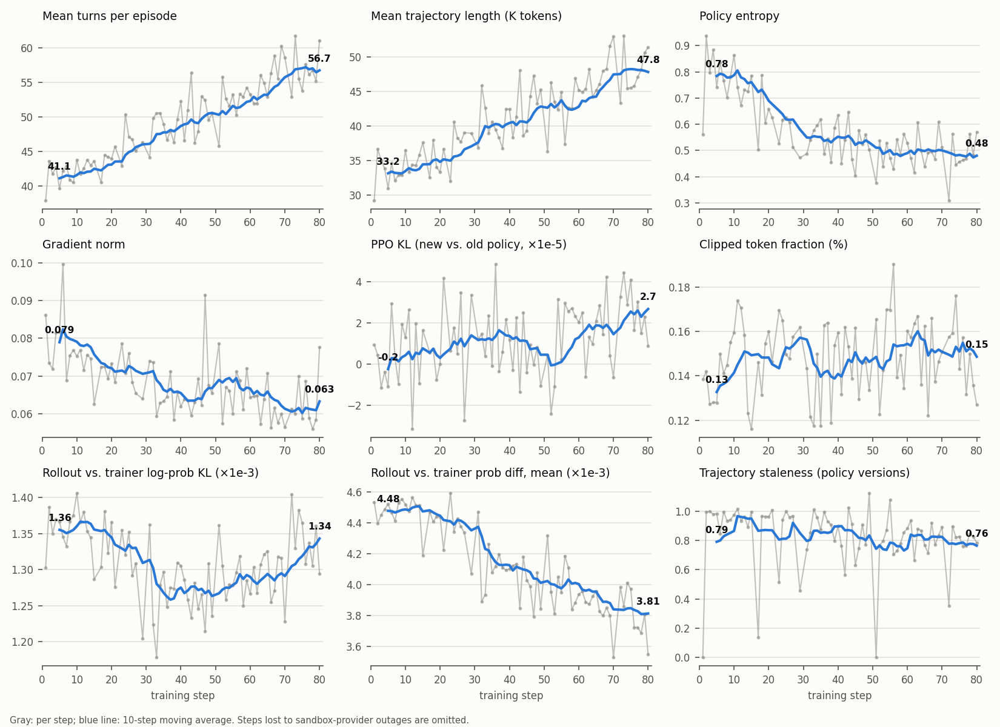

# Run Training on AMD GPUs

*Authors: Yuhan Yang ([yuhanya@amd.com](mailto:yuhanya@amd.com)), Liz Li, Xinyu Kang, Shiyu Nie, Andy Luo, Fuwei Yang*

Uni-Agent runs the same Agent workflow on AMD Instinct GPUs with ROCm. This recipe uses verl's separate asynchronous trainer: rollout and training run on different nodes, so rollout never waits for a training step.

This guide trains `Qwen3-Coder-30B-A3B-Instruct` with the white-box `ReAct Agent` on 3 nodes of AMD Instinct MI355X, using E2B sandboxes.

## Prerequisites

- A ROCm environment with verl, vLLM, and Megatron-LM. The recipe was run in the `verlai/verl:rocm7.14_torch2.12_release_0724` image (ROCm 7.14, PyTorch 2.12, vLLM 0.26, Ray 2.56). Start the container with `--device /dev/kfd --device /dev/dri --network host --ipc host` and mount the shared data directory.
- A Ray cluster with 3 nodes × 8 GPUs: 2 rollout nodes and 1 training node.
- An E2B deployment, either hosted or self-hosted. Put `E2B_API_KEY` in the Ray runtime environment, and also `E2B_API_URL` and `E2B_SANDBOX_URL` for a self-hosted deployment. Do not commit real keys.
- Datasets and the Ray Runtime Environment prepared as described in [Run Agent RL Training](rl-training.md). This recipe trains on the processed [`swe-rebench-filtered-1150`](https://huggingface.co/datasets/dyyyyyyyy/swe-rebench-filtered-1150) dataset and validates on SWE-bench Verified.
- A ReAct Task Config that uses E2B sandboxes. Start from `examples/quickstart/training/task_config_react.yaml` and replace the `sandbox` block of each task, as described in [Launch a Sandbox](launch-sandbox.md):

    ```yaml
    sandbox:
      provider: e2b
      runtime_timeout: 3600
      sandbox_kwargs:
        cpu_count: 2
        memory_mb: 4096
    ```

## Launch Training

Set the shared data and runtime roots, then launch from the repository root:

```bash
DATA_DIR=/path/to/data \
RUNTIME_DIR=/path/to/runtime \
NNODES=1 \
ROLLOUT_NNODES=2 \
NGPUS_PER_NODE=8 \
ROLLOUT_NGPUS_PER_NODE=8 \
GEN_TP=4 \
TP=4 \
EP=8 \
CONCURRENCY=1024 \
TRAIN_PROMPT_BSZ=64 \
N_RESP_PER_PROMPT=8 \
PPO_MINI_BATCH_SIZE=16 \
PARAMETER_SYNC_STEP=4 \
TRAIN_FILE=/path/to/data/swe_rebench_filtered_1150.parquet \
TEST_FILE=/path/to/data/swe_bench_verified.parquet \
TASK_CONFIG=/path/to/task_config_react_e2b.yaml \
RUNTIME_ENV=/path/to/runtime_env.yaml \
EXP_NAME=react_qwen3_coder_30b_rocm_grpo \
ADV_ESTIMATOR=grpo \
LOSS_MODE=vanilla \
TEST_FREQ=-1 \
bash examples/quickstart/training/train_rocm_qwen3_moe.sh
```

The default layout is:

```text
<DATA_DIR>/
├── models/Qwen3-Coder-30B-A3B-Instruct/
└── data/
    ├── swe_rebench_filtered_1150.parquet
    └── swe_bench_verified.parquet
<RUNTIME_DIR>/
├── ckpts/
└── logs/
```

Override `MODEL_PATH`, `TRAIN_FILE`, `TEST_FILE`, `RUNTIME_ENV`, or `TASK_CONFIG` when your layout differs.

The recipe sets `trainer.use_v1=True` with `trainer.v1.trainer_mode=separate_async`. Rollout runs on `ROLLOUT_NNODES` nodes as standalone vLLM replicas with tensor parallelism `GEN_TP`. The actor trains on `NNODES` nodes with Megatron (TP=`TP`, EP=`EP`, full recompute, grouped-GEMM MoE). `TRAIN_PROMPT_BSZ` must equal `PARAMETER_SYNC_STEP × PPO_MINI_BATCH_SIZE`, and weights are synced to the rollout replicas over NCCL once per step. The ROCm-specific settings are `disable_custom_all_reduce` for vLLM and vLLM's Triton MoE kernels. AITER MoE needs a newer `aiter` than the image provides.

The E2B task config gives each task a 2 vCPU / 4 GB sandbox, a 200-turn budget, and a 128K context. On E2B, the sandbox size is part of the template name, so build templates with the same size before you change `cpu_count` or `memory_mb`.

## Monitor the Run

Checkpoints and per-session Agent logs are written under:

```text
<RUNTIME_DIR>/ckpts/<PROJECT_NAME>/<EXP_NAME>/
<RUNTIME_DIR>/logs/<PROJECT_NAME>/<EXP_NAME>/
```

Each step writes one directory of session logs. If a whole step shows `critic/score/mean` near 0 and `actor/grad_norm` near 0, check those logs for unreachable E2B sandboxes before suspecting the model: a sandbox-provider outage can take down most of a step's batch.

## Evaluate a Checkpoint

The launch command disables in-training validation (`TEST_FREQ=-1`). To evaluate a checkpoint, serve its Hugging Face export with vLLM and run the inference script from [Run Agent Inference](agent-inference.md) on SWE-bench Verified:

```bash
vllm serve <RUNTIME_DIR>/ckpts/<PROJECT_NAME>/<EXP_NAME>/global_step_80/actor/model/huggingface \
  --served-model-name step80 --tensor-parallel-size 4 --max-model-len 131072 \
  --enable-auto-tool-choice --tool-call-parser qwen3_coder --port 8000

python3 examples/inference/parallel_infer_api.py \
  --data-path /path/to/data/swe_bench_verified.parquet \
  --task-config /path/to/task_config_react_e2b.yaml \
  --base-url http://localhost:8000/v1 --model step80 --api-key EMPTY \
  --concurrency 32 --result-path step80.json
```

The results below use the `swe_bench` task of the same Task Config with `top_p: 0.95` in `sampling_params_override`, one sample per task. Rerun tasks whose sandbox became unreachable before you compute the score.

## Results

Qwen3-Coder-30B-A3B-Instruct trained on SWE-rebench (1,150 tasks) with GRPO (clip 0.2 / 0.28, no KL, token-mean, lr 1e-6, 64 × 8 rollouts per step), 200 turns, 128K context, on 3 × 8 MI355X. Each checkpoint was evaluated on SWE-bench Verified (500 tasks) with one sample per task, temperature 1.0 and top-p 0.95. Tasks interrupted by sandbox infrastructure failures were rerun.

| Checkpoint | Base | 10 | 20 | 30 | 40 | 50 | 60 | 70 | 80 |
| --- | ---: | ---: | ---: | ---: | ---: | ---: | ---: | ---: | ---: |
| SWE-bench Verified (%) | 47.8 | 49.2 | 48.0 | 49.4 | 52.6 | **53.4** | 52.2 | 52.4 | 53.2 |

{ width="900" }

- From step 40 on, every checkpoint is about 5 points above the base model, and each is significant in a paired McNemar test on the same 500 tasks (*p* ≤ 0.02). For example, base vs. step 80: 29 tasks solved only by the base model, 56 only by step 80, *p* = 0.005. Differences between neighbouring checkpoints after step 40 are not significant.
- The result is in line with the GSPO colocate-async reference for this model and dataset (47.4 → 54.2) in [RL Training](../benchmark/rl-training.md). One sample per task gives each score a 95% interval of about ±4.4 points.

### Training Reward

{ width="900" }

The 10-step moving average of the training reward rises from 0.26 to 0.33. Per-step reward is noisy: the standard deviation around the moving average is 0.038, and resampling 64 tasks × 8 rollouts from the observed per-task pass rates gives 0.035. Almost all step-to-step noise comes from which tasks a step draws. Steps 16, 22, 28, 30, 50, and 71 lost most of their batch to sandbox-provider outages, which shows as reward near 0.

### Training Dynamics

{ width="1000" }

Episodes get longer as training proceeds. Entropy settles at about 0.5 after step 40. KL, clip fraction, gradient norm, and the rollout–trainer mismatch stay small throughout.

### Sandbox Reliability

Each rollout runs in its own E2B sandbox, about 540 at once during training. Outside the six outage steps, about 2% of sessions lost their sandbox, which lowers the mean reward by about 0.006. Provider outages are not the model's fault, so evaluation tasks interrupted this way were rerun.
