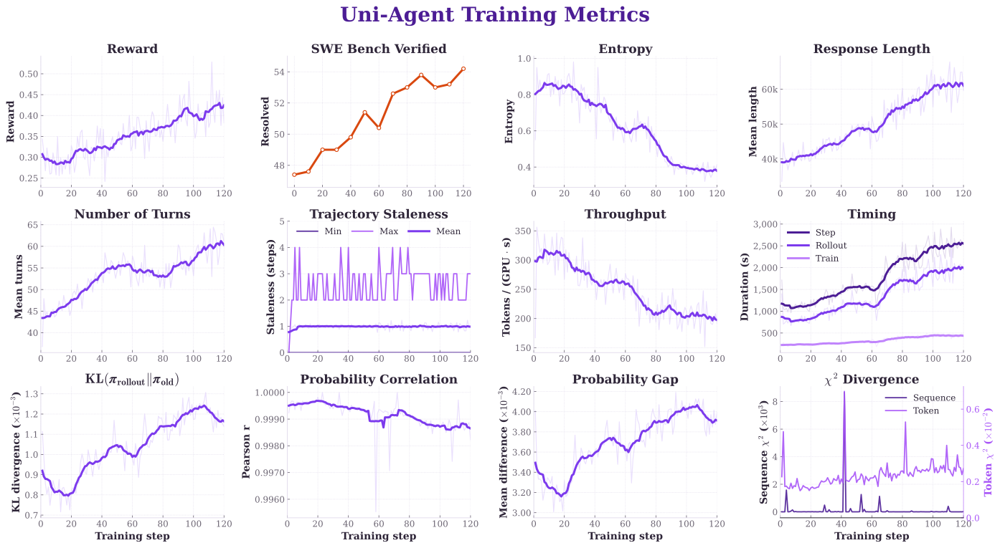
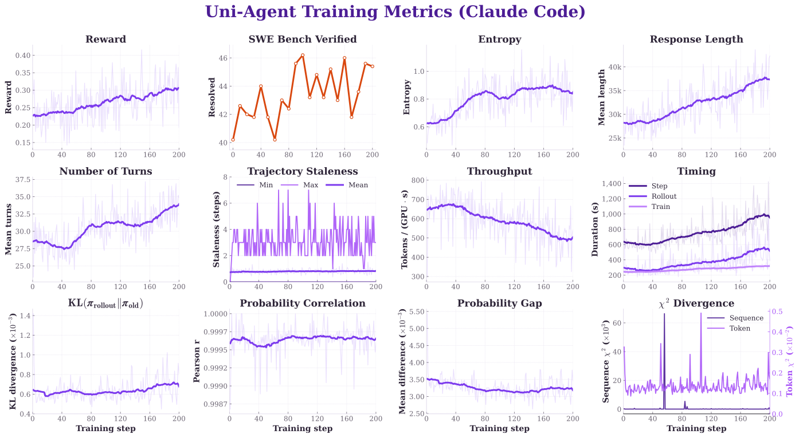
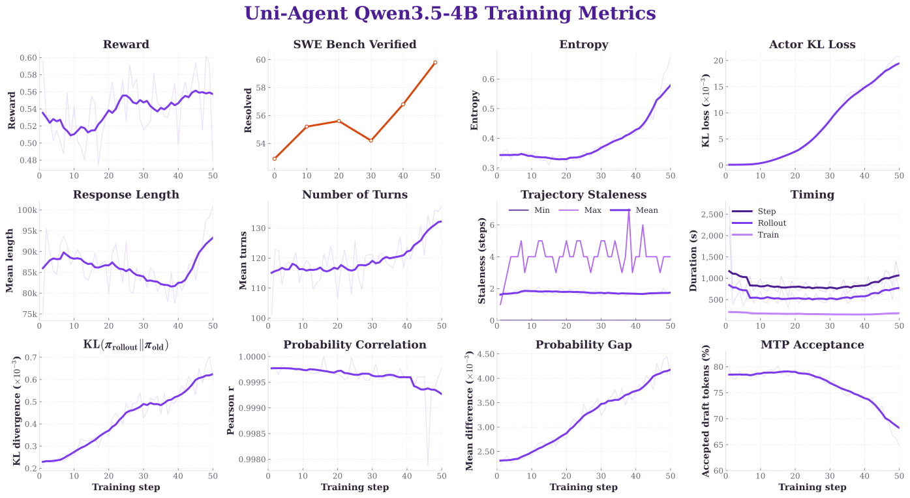
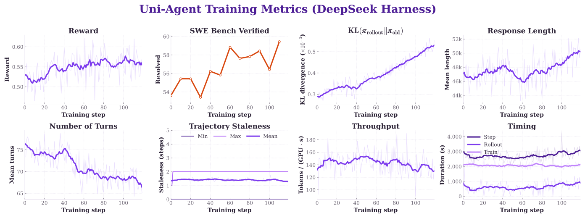

# Run Agent RL Training

Uni-Agent supports RL training for both white-box and black-box Agents. By integrating with the bundled `verl` module, the same Agent workflow can move seamlessly from inference to training.

This guide demonstrates:

1. Train `Qwen3-Coder-30B-A3B-Instruct` with the white-box `ReAct Agent`.
2. Train `Qwen3-Coder-30B-A3B-Instruct` with the black-box `Claude Code` Agent.
3. Train `Qwen3.5-4B` with the white-box `ReAct Agent` using colocated asynchronous rollout.
4. Train `Qwen3.5-9B` with the black-box `DeepSeek Harness` Agent.

## Prerequisites

We recommend completing the preceding Quickstart guides before starting training to ensure that the Task dependencies and Sandbox service are working correctly.

## Prepare the Data

All examples train on SWE-reBench and validate on SWE-Bench Verified. The preprocessors convert each dataset row into the Task Config format consumed by Uni-Agent.

### Training Dataset

!!! note "Ready-to-use SWE-reBench dataset"
    You can directly use our processed `swe-rebench-filtered-1150` dataset, which contains 1,150 training samples. We preprocess and filter the original SWE-reBench examples to make them better suited for Agent RL training.

    **Dataset:** [https://huggingface.co/datasets/dyyyyyyyy/swe-rebench-filtered-1150](https://huggingface.co/datasets/dyyyyyyyy/swe-rebench-filtered-1150)

Prepare the filtered SWE-reBench split:

```bash
python3 -m uni_agent.tasks.swe_rebench.preprocess --local-save-dir ~/data/uni_agent
```

The command writes: `~/data/uni_agent/swe_rebench_filtered.parquet`

### Validation Dataset

Prepare SWE-Bench Verified:

```bash
python3 -m uni_agent.tasks.swe_bench.preprocess --local-save-dir ~/data/uni_agent
```

The command writes: `~/data/uni_agent/swe_bench_verified.parquet`

The processed rows remain independent of the runtime Sandbox provider and Agent protocol. Each row contains one dataset/source user message with the problem statement, task metadata, a canonical image reference, and a per-sample Task Config. The selected ReAct or Claude Code recipe owns the complete `prompt_template` and formats its Task messages from metadata at runtime.

!!! warning "Prompt length filtering"
    The standard verl dataset filters by the source prompt before the runtime Task template is expanded. A source message can therefore pass the configured prompt-length check even when its Agent-facing prompt is longer. Size prompt limits with the selected recipe template in mind.

## Configuration

### Task Configuration

The Quickstart provides separate Task Configs for ReAct and Claude Code. Each recipe owns its prompt template and Agent-specific behavior.

=== "ReAct"

    ```yaml
    - name: swe_bench
      sandbox:
        provider: vefaas  # <-- Change to your Sandbox provider.
        runtime_timeout: 7200
      agent:
        name: react
        max_steps: 200
        tools:
          - name: str_replace_editor
          - name: stateful_shell
            command_timeout: 120
            env_vars:
              PAGER: "cat"
              GIT_PAGER: "cat"
              MANPAGER: "cat"
              TQDM_DISABLE: "1"
              PIP_PROGRESS_BAR: "off"
          - name: submit
        sampling_params_override:
          temperature: 1.0
          top_p: 1.0

    - name: swe_rebench
      sandbox:
        provider: vefaas  # <-- Change to your Sandbox provider.
        runtime_timeout: 7200
      agent:
        name: react
        max_steps: 200
        tools:
          - name: str_replace_editor
          - name: stateful_shell
            command_timeout: 120
            env_vars:
              PAGER: "cat"
              GIT_PAGER: "cat"
              MANPAGER: "cat"
              TQDM_DISABLE: "1"
              PIP_PROGRESS_BAR: "off"
          - name: submit
        sampling_params_override:
          temperature: 1.0
          top_p: 1.0
    ```

=== "Claude Code"

    ```yaml
    - name: swe_bench
      sandbox:
        provider: vefaas  # <-- Change to your Sandbox provider.
        runtime_timeout: 7200
      agent:
        name: claude_code
        max_turns: 200
        run_timeout: 4800

    - name: swe_rebench
      sandbox:
        provider: vefaas  # <-- Change to your Sandbox provider.
        runtime_timeout: 7200
      agent:
        name: claude_code
        max_turns: 200
        run_timeout: 4800
    ```

    !!! warning "Network connectivity"
        The Claude Code sandbox must be able to reach the GPU machine hosting its session-scoped Gateway endpoint.

=== "DeepSeek Harness"

    ```yaml
    - name: swe_rebench
      sandbox:
        provider: openyuanrong  # the reverse tunnel is openYuanrong-only
        runtime_timeout: 7200
        image_mounts:
          - image: swr.cn-east-3.myhuaweicloud.com/openyuanrong/dsh-tool:latest
            mount_path: /opt/dsh
        executable_paths:
          dsh: /opt/dsh/bin/dsh
          node: /opt/dsh/bin/node
        sandbox_kwargs:
          proxy_port: 38197
      agent:
        name: deepseek_harness
        run_timeout: 7200
        conda_env_path: /opt/miniconda3/envs/testbed
        tool_mode: minimal
        step_limit: 100
    ```

    The `swe_bench` entry is identical apart from `name`. The full Task Config ships at
    `examples/deepseek_harness/task_config_deepseek_harness.yaml`.

    !!! warning "openYuanrong only"
        This recipe drives the in-sandbox `dsh` CLI through the session-scoped
        Gateway reverse tunnel (`sandbox.sandbox_kwargs.proxy_port`), which is an
        openYuanrong capability. The other sandbox providers cannot serve it.

The ReAct launchers permit these request overrides through the Agent Framework
allowlist. See [Sampling configuration](../concepts/gateway-and-trajectories.md#sampling-configuration)
for its syntax and precedence.

Some sandbox providers requires self-hosted task images instead of pulling directly from Docker Hub, you can set `sandbox.image_map` in the Task Config. See [`image_map`](../concepts/sandbox.md#image_map) for details.

For prompt resolution, template validation, and `raw_prompt` semantics, see [Source Prompts and Runtime Templates](../concepts/task-and-reward.md#source-prompts-and-runtime-templates).

### Ray Runtime Environment

Training runs as a Ray job. Use a Runtime Environment to distribute the repository, expose the bundled `verl` source, install lightweight Task and Sandbox dependencies, and pass credentials to every Agent runner.

=== "veFaaS"

    ```yaml
    working_dir: ./
    excludes: ["/.git/"]

    pip:
      packages:
        - "volcengine-python-sdk"
        - "swe-rex"
        - "swebench==4.1.0"

    env_vars:
      PYTHONPATH: "verl"
      PYTHONNOUSERSITE: "1"
      TORCH_NCCL_AVOID_RECORD_STREAMS: "1"
      CUDA_DEVICE_MAX_CONNECTIONS: "1"

      VEFAAS_FUNCTION_ID: "<vefaas-function-id>"
      VEFAAS_FUNCTION_ROUTE: "<vefaas-function-route>"
      VOLCE_ACCESS_KEY: "<volcengine-access-key>"
      VOLCE_SECRET_KEY: "<volcengine-secret-key>"
    ```

=== "Modal"

    ```yaml
    working_dir: ./
    excludes: ["/.git/"]

    pip:
      packages:
        - "modal"
        - "swebench==4.1.0"

    env_vars:
      PYTHONPATH: "verl"
      PYTHONNOUSERSITE: "1"
      TORCH_NCCL_AVOID_RECORD_STREAMS: "1"
      CUDA_DEVICE_MAX_CONNECTIONS: "1"

      MODAL_TOKEN_ID: "<modal-token-id>"
      MODAL_TOKEN_SECRET: "<modal-token-secret>"
    ```

## Case 1: ReAct Agent RL

### Launch Training

This recipe trains `Qwen3-Coder-30B-A3B-Instruct` with the ReAct Task Config. Set the shared data and runtime roots, then launch it from the repository root:

```bash
DATA_DIR=/path/to/data \
RUNTIME_DIR=/path/to/runtime \
NNODES=8 \
CONCURRENCY=1024 \
GEN_TP=4 \
TP=1 PP=2 CP=4 EP=8 ETP=1 \
TRAIN_PROMPT_BSZ=64 \
N_RESP_PER_PROMPT=8 \
PPO_MINI_BATCH_SIZE=16 \
TASK_CONFIG=examples/quickstart/training/task_config_react.yaml \
MASK_UNFINISHED_EPISODE=True \
EXP_NAME=react_qwen3_coder_30b_gspo_r3 \
ADV_ESTIMATOR=grpo \
LOSS_MODE=gspo \
CLIP_RATIO_LOW=4e-4 \
CLIP_RATIO_HIGH=4e-4 \
CLIP_RATIO_C=10 \
LOSS_AGG_MODE=token-mean \
BYPASS_MODE=False \
ROLLOUT_IS=token \
ROLLOUT_IS_THRESHOLD=2.0 \
ROLLOUT_IS_BATCH_NORMALIZE=False \
ROLLOUT_RS=null \
ROUTER_REPLAY_MODE=R3 \
ENABLE_ROLLOUT_ROUTING_REPLAY=True \
LR_DECAY_STEPS=10000 \
TEST_FREQ=-1 \
bash examples/quickstart/training/train_qwen3_moe.sh
```

The default layout is:

```text
<DATA_DIR>/
├── models/Qwen3-Coder-30B-A3B-Instruct/
└── data/uni_agent/
    ├── swe_rebench_filtered_1150.parquet
    └── swe_bench_verified.parquet

<RUNTIME_DIR>/
├── data/uni_agent/runtime_env.yaml
├── ckpts/
└── logs/
```

Override `MODEL_PATH`, `TRAIN_FILE`, `TEST_FILE`, `RUNTIME_ENV`, or `TASK_CONFIG` when your layout differs.

### Monitor the Run

Checkpoints and per-session Agent logs are written under:

```text
<RUNTIME_DIR>/ckpts/Uni-Agent-Qwen3-Coder-30B-megatron/<EXP_NAME>/
<RUNTIME_DIR>/logs/Uni-Agent-Qwen3-Coder-30B-megatron/<EXP_NAME>/
```

### Results

The following dashboard summarizes reward, SWE-Bench Verified performance, rollout behavior, throughput, timing, and policy-drift metrics for this run:

{ width="1200" }

## Case 2: Claude Code RL

### Launch Training

This recipe trains `Qwen3-Coder-30B-A3B-Instruct` with the Claude Code Task Config. Parallelism, GSPO, and Router Replay match the ReAct recipe above; the Claude Code runner additionally keeps `trajectory_selection=longest`:

```bash
DATA_DIR=/path/to/data \
RUNTIME_DIR=/path/to/runtime \
NNODES=8 \
CONCURRENCY=1024 \
GEN_TP=4 \
TP=1 PP=2 CP=4 EP=8 ETP=1 \
TRAIN_PROMPT_BSZ=32 \
N_RESP_PER_PROMPT=16 \
PPO_MINI_BATCH_SIZE=16 \
TASK_CONFIG=examples/quickstart/training/task_config_claude_code.yaml \
TRAJECTORY_SELECTION=longest \
MASK_UNFINISHED_EPISODE=True \
EXP_NAME=claude_code_qwen3_coder_30b_gspo_r3 \
ADV_ESTIMATOR=grpo \
LOSS_MODE=gspo \
CLIP_RATIO_LOW=4e-4 \
CLIP_RATIO_HIGH=4e-4 \
CLIP_RATIO_C=10 \
LOSS_AGG_MODE=token-mean \
BYPASS_MODE=False \
ROLLOUT_IS=token \
ROLLOUT_IS_THRESHOLD=2.0 \
ROLLOUT_IS_BATCH_NORMALIZE=False \
ROLLOUT_RS=null \
ROUTER_REPLAY_MODE=R3 \
ENABLE_ROLLOUT_ROUTING_REPLAY=True \
LR_DECAY_STEPS=10000 \
TEST_FREQ=-1 \
bash examples/quickstart/training/train_qwen3_moe.sh
```

The Claude Code runner sets `trajectory_selection=longest`. If a Gateway session materializes multiple trajectories, the Framework keeps only the trajectory with the most model-generated tokens for RL training.

`train_qwen3_moe.sh` passes `MASK_UNFINISHED_EPISODE` to the Agent Framework. It defaults to `False`, which trains on every finalized trajectory.
The commands above opt in explicitly: completed Task rewards and trajectories are still retained, but tokens from Agents that did not finish normally are excluded from policy optimization. Agents that report no completion state stay trainable either way.

The script expects:

```text
<DATA_DIR>/
├── models/Qwen3-Coder-30B-A3B-Instruct/
└── data/uni_agent/
    ├── swe_rebench_filtered_1150.parquet
    └── swe_bench_verified.parquet

<RUNTIME_DIR>/
├── data/uni_agent/runtime_env.yaml
├── ckpts/
└── logs/
```

The Claude Code sandbox must be able to reach the session-scoped Gateway running on the GPU cluster.

### Monitor the Run

Outputs are written under:

```text
<RUNTIME_DIR>/ckpts/Uni-Agent-Qwen3-Coder-30B-megatron/<EXP_NAME>/
<RUNTIME_DIR>/logs/Uni-Agent-Qwen3-Coder-30B-megatron/<EXP_NAME>/
```

### Results

The following dashboard summarizes reward, SWE-Bench Verified performance, rollout behavior, throughput, timing, and policy-drift metrics for this run:

{ width="1200" }

## Case 3: Qwen3.5-4B ReAct Agent RL

### Launch Training

This recipe trains `Qwen3.5-4B` with the ReAct Task Config on 64 H100 GPUs. Actor training and asynchronous vLLM rollout share all GPUs in `colocate_async` mode:

```bash
DATA_DIR=/path/to/data \
RUNTIME_DIR=/path/to/runtime \
NNODES=8 \
NGPUS_PER_NODE=8 \
CONCURRENCY=1024 \
GATEWAY_COUNT=32 \
TRAIN_PROMPT_BSZ=64 \
N_RESP_PER_PROMPT=8 \
PPO_MINI_BATCH_SIZE=16 \
MAX_PROMPT_LENGTH=8192 \
MAX_RESPONSE_LENGTH=131072 \
CP=4 \
TASK_CONFIG=examples/quickstart/training/task_config_react.yaml \
EXP_NAME=react_qwen3p5_4b_grpo \
bash examples/quickstart/training/train_qwen3p5_dense.sh
```

The default configuration uses GRPO, a `1e-6` learning rate with 10 warmup steps, 512 trajectories per training step, and two-token MTP speculative decoding. The ReAct Task Config allows up to 200 Agent steps. Checkpoints are saved every 10 training steps; set `TEST_FREQ` when online validation is desired.

The expected data and runtime layouts are the same as Case 1, except that the default model directory is:

```text
<DATA_DIR>/models/Qwen3.5-4B/
```

### Monitor the Run

Checkpoints and per-session Agent logs are written under:

```text
<RUNTIME_DIR>/ckpts/Uni-Agent-Qwen3.5-4B-megatron-64g/<EXP_NAME>/
<RUNTIME_DIR>/logs/Uni-Agent-Qwen3.5-4B-megatron-64g/<EXP_NAME>/
```

### Results

Over the first 50 training steps, the SWE-Bench Verified resolved rate increases from **52.9%** to **59.8%**, a gain of **6.9 percentage points**. Evaluation uses the initial model and checkpoints at 10-step intervals; the training panels show logged scalars over the same 50-step window.

{ width="1200" }

## Case 4: DeepSeek Harness RL

This recipe trains `Qwen3.5-9B` with the black-box `DeepSeek Harness` Agent: the
real `dsh --profile headless` CLI runs inside the task sandbox from a sidecar tool
image, calls the policy through the session-scoped Gateway over a reverse tunnel,
and the reward is evaluated in the same sandbox. The Task Config is the single
per-task source of truth; the training script only wires the framework.

### Prerequisites

Beyond the shared [Prepare the Data](#prepare-the-data) step, this recipe needs:

1. **openYuanrong credentials.** Export `OPENYUANRONG_SERVER_ADDRESS` and
   `OPENYUANRONG_TOKEN`; the recipe creates one sandbox per rollout session.
2. **The DSH tool image**, built once and pushed to a registry the sandbox can pull
   from:

   ```bash
   bash examples/deepseek_harness/build_tool.sh \
       --registry swr.cn-east-3.myhuaweicloud.com/openyuanrong
   ```

   `--dsh-version`, `--base-image`, and `--npm-registry` support pinned and
   mirrored builds. The image is referenced by `sandbox.image_mounts[0].image` in
   the Task Config, **not** by the training script — keep the two in sync.
3. **The preprocessed parquet files** from [Prepare the Data](#prepare-the-data).
   The recipe's own defaults point elsewhere, so pass `TRAIN_DATA` / `VAL_DATA`
   explicitly (see below).

### Launch Training

The deployment below runs on an 8-node Ascend NPU 910B cluster (8 cards per node):

```bash
OPENYUANRONG_SERVER_ADDRESS="<server-address>" \
OPENYUANRONG_TOKEN="<token>" \
MODEL_PATH=~/models/Qwen3.5-9B \
TRAIN_DATA=~/data/uni_agent/swe_rebench_filtered_1150.parquet \
VAL_DATA=~/data/uni_agent/swe_bench_verified.parquet \
NNODES=8 \
N_GPUS_PER_NODE=8 \
ROLLOUT_NNODES=4 \
ROLLOUT_NGPUS_PER_NODE=8 \
TRAIN_TP=4 \
TRAIN_PP=2 \
TRAIN_CP=4 \
GEN_TP=2 \
GATEWAY_COUNT=32 \
MAX_CONCURRENT_SESSIONS=320 \
TRAIN_BATCH_SIZE=64 \
PPO_MINI_BATCH_SIZE=16 \
N=8 \
PROMPT_LENGTH=8192 \
RESPONSE_LENGTH=131072 \
bash examples/deepseek_harness/run_train.sh
```

Parallelism and batch layout:

- **Trainer pool** — `NNODES x N_GPUS_PER_NODE` Megatron workers with
  `TRAIN_TP=4 / TRAIN_PP=2 / TRAIN_CP=4`.
- **Rollout pool** — `ROLLOUT_NNODES x ROLLOUT_NGPUS_PER_NODE` vLLM workers
  (`ENGINE=vllm`) with `GEN_TP=2`, sampling `N=8` responses per prompt, with at most
  `MAX_CONCURRENT_SESSIONS=320` sessions in flight.
- **Batch layout** — `TRAIN_BATCH_SIZE=64` prompts per step, `PPO_MINI_BATCH_SIZE=16`,
  and a sequence budget of `PROMPT_LENGTH=8192` + `RESPONSE_LENGTH=131072`
  (`PROMPT_LENGTH + RESPONSE_LENGTH` is also the Gateway trajectory capacity).
- **Gateway pool** — `GATEWAY_COUNT` Gateway actors front the engine; the reverse
  tunnel routes each in-sandbox `dsh` to one of them.

This launcher starts Ray with NPU resources by default
(`ray start --resources='{"NPU": <total>}'`, where the total is the trainer plus the
rollout pool) and exports `NCCL_P2P_DISABLE=1` / `NCCL_SHM_DISABLE=1` for multi-node
NPU communication. On a GPU cluster, start Ray with `--num-gpus=<total>` instead.

`run_train.sh` submits a Megatron V1 job in `separate_async` mode (separate train
and rollout pools) with a pool of `GATEWAY_COUNT` Gateway actors fronting the
engine.

- **Reverse tunnel.** The sandbox reaches the policy without a route to the GPU
  cluster: `run_task` rewrites `agent.model.base_url` to
  `http://127.0.0.1:<proxy_port>/v1`, where `proxy_port` is
  `sandbox.sandbox_kwargs.proxy_port` — the single source of truth.
- **Runtime data hygiene.** The agent emits a DSH patch that disables auto
  session-title generation and auto context compaction, so each rollout yields one
  clean trajectory instead of a 1-turn title row or a compact-boundary split.
  Controlled by `agent.disable_title_generation` / `agent.disable_auto_compaction`
  (both default `true`).
- **Tool surface.** `agent.tool_mode=minimal` (the default) restricts DSH to
  `bash` + `str_replace_editor` through the baked `minimal_patch.yml`; `"full"`
  keeps the 25-tool Code Mode surface.
- **Time budgets.** Four knobs bound an episode and the smallest wins:
  `agent.step_limit` (`100`), `agent.run_timeout` (`7200`),
  `sandbox.runtime_timeout` (`7200`), and `SESSION_TIMEOUT_SECONDS` (`2400`).
  With the shipped defaults the framework cap fires first: the sample is dropped
  from the batch without stopping training.

`TOOL_PARSER` (default `qwen3_coder`) must match the served model's chat template,
and `MASK_UNFINISHED_EPISODE=True` (the default here) zeroes the loss mask for
episodes that did not finish normally — a watchdog kill, a timeout, or a crash.

The complete knob reference lives in `examples/deepseek_harness/README.md`.

### Monitor the Run

- Per-session Agent logs land under `AGENT_LOG_DIR`
  (default `/home/${USER}/uni_agent_logs`), one `step_<N>/<session-id>/` directory
  per session. Export `USER` or set `AGENT_LOG_DIR` explicitly on hosts where
  `USER` is unset (Docker, CI, cron).
- Training checkpoints go to `CKPTS_DIR`
  (default `checkpoints/${PROJECT_NAME}/${EXPERIMENT_NAME}`).

### Results

The following dashboard summarizes reward, SWE-Bench Verified performance, rollout behavior, throughput, timing, and policy-drift metrics for this run:


