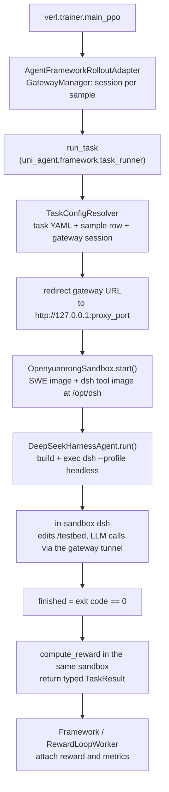

# DeepSeek Harness Blackbox Training Recipe

Train a policy to drive the real [DeepSeek Harness](https://www.npmjs.com/package/@deepseek-ai/dsh)
(`dsh --profile headless`) on SWE-bench / SWE-reBench tasks. DSH runs **inside** the
task sandbox from a sidecar tool image, calls the LLM policy through the gateway
(via a reverse tunnel because the sandbox is remote), and the reward is evaluated in
the same sandbox. The pipeline is wired into verl's black-box agent framework -- no
custom rollouter code required.

## How it works



Per sample, `uni_agent.framework.task_runner.run_task`:

1. **Resolve** the task config (per-task YAML defaults + sample row + gateway session binding).
2. **Connect** to the gateway: the session URL is rewritten to the sandbox-internal
   `127.0.0.1:<proxy_port>`, so the sandbox reaches the policy through the reverse
   tunnel without a direct route to the training cluster.
3. **Launch** DSH inside the sandbox. Unlike `mini_swe_agent` there is no in-sandbox
   `run_agent.py` entrypoint: `dsh` *is* the agent binary, so the agent only builds
   and execs the command.
4. **Score** in the same sandbox and return the reward in `TaskResult`; the framework
   passes it through the configured RewardLoop scorer and attaches the resulting
   reward and metrics to the finalized trajectory.

### What the agent injects into the DSH command

`DeepSeekHarnessAgent.run()` assembles one shell script (executed via
`Sandbox.exec_shell`) that:

| Step | Purpose |
|---|---|
| `cat > /tmp/dsh_model_patch.yml` | Points DSH's `llm-deepseek` route at the served model (DSH otherwise requests its own catalog model, which a vLLM / OpenAI-compatible server 404s). Written whenever `agent.model.model_name` is set, which `run_train.sh` always does via `SERVED_MODEL_NAME`; setting `agent.max_model_len` additionally advertises that context and caps the per-request `maxTokens` below it. |
| `cat > /tmp/dsh_session_patch.yml` | Forces `session-persistence-jsonl` to `compression: none` so the step watchdog can read a plaintext `session.jsonl`. Only written when `agent.step_limit` is set. |
| `cat > /tmp/dsh_data_hygiene.yml` | Disables DSH's auto session-title generation and auto context compaction (see `agent.disable_title_generation` / `agent.disable_auto_compaction`). |
| `cd <workdir>; mkdir -p /tmp/dsh-home` | Working directory and DSH home. |
| `dsh --profile headless --patch ... <task>` | The launch itself, with `DEEPSEEK_BASE_URL` pointed at the tunnel. |
| watchdog + `wait` | Enforces `agent.step_limit` (see below). |

`agent.tool_mode=minimal` additionally passes `--patch /opt/dsh/minimal_patch.yml`,
which restricts the tool surface to `bash` + `str_replace_editor` (the baked
25-tool Code Mode surface otherwise dominates the request and the model's system
prompt).

### Step limit

DSH has no native `--max-turns` flag. When `agent.step_limit` is set, the launch
runs `dsh` in the background and starts a watchdog beside it that counts
`"type":"step/start"` lines under `$DSH_HOME/sessions/*/*/session.jsonl` every 0.5s
and, at the limit, kills **that exact PID** (`$!` captured right after the launch).
A killed `dsh` exits non-zero, so the episode reports `finished=False` and is masked
from the loss by `MASK_UNFINISHED_EPISODE`. Targeting the PID (rather than a
command-line pattern) matters because `exec_shell` runs the generated script through
`bash -c <script>`, which puts the whole script text on the shell's own command line.

## Prerequisites

| # | Requirement | Notes |
|---|---|---|
| 1 | **OpenYuanrong sandbox account** | [Deploy a sandbox cluster](#sandbox-provider); set `OPENYUANRONG_SERVER_ADDRESS` and `OPENYUANRONG_TOKEN` |
| 2 | **Tool image built & reachable by the sandbox service** | see [Build the tool image](#2-build-the-tool-image); push to a registry the sandbox service can pull from |
| 3 | **Preprocessed dataset** | see [Prepare data](#3-prepare-data) |
| 4 | **A policy model** | any path / `hf://` ref accepted by the vLLM engine (`MODEL_PATH`) |
| 5 | **Multi-node NPU/GPU cluster** | `run_train.sh` starts Ray with `NPU` resources by default; GPU users switch the `ray start` flags |

> Verified against verl **`release/v0.9.1`** (`separate_async` trainer mode + the
> black-box agent framework), matching the other black-box recipes in this repo.

### Sandbox provider

This recipe uses the openYuanrong sandbox for task execution and reward computation,
and a reverse tunnel so the in-sandbox DSH can reach the gateway. Before launching
training, complete the sandbox service deployment and access enablement, then verify:

- A valid service endpoint and access token.
- The sandbox cluster can pull both the SWE dataset images and the custom sidecar tool image.

## Quick start

### 1. Installation

Follow the repository install guide, including a verl checkout at `release/v0.9.1`
and the openYuanrong sandbox SDK.

### 2. Build the tool image

The tool image is a `FROM scratch` layer rooted so that, once mounted at `/opt/dsh`,
it exposes `bin/dsh`, `bin/node` and `minimal_patch.yml` directly under the mount
target. It ships the DSH Node CLI **plus a node runtime**, because the SWE task
images have no node.

```bash
# Local build (default base image node:22-bookworm-slim).
bash examples/deepseek_harness/build_tool.sh

# Build behind an npm mirror.
bash examples/deepseek_harness/build_tool.sh --npm-registry https://registry.npmmirror.com

# Pin a DSH version and a mirrored base image.
bash examples/deepseek_harness/build_tool.sh --dsh-version 0.1.0-rc.8 \
    --base-image docker.m.daocloud.io/library/node:22-bookworm-slim

# Build, tag for the remote registry, and push.
bash examples/deepseek_harness/build_tool.sh \
    --registry swr.cn-east-3.myhuaweicloud.com/openyuanrong
```

> The image is referenced from `task_config_deepseek_harness.yaml`
> (`sandbox.image_mounts[0].image`), **not** from the training script.
> If the sandbox service cannot pull it, change that URL (or push to a registry it
> can reach) and keep the two in sync.

### 3. Prepare data

Re-run the preprocessors so each parquet row carries the task payload consumed by
`run_task` (`extra_info.tools_kwargs.task` with `{name, sandbox:{image: canonical}, metadata}`):

```bash
python -m uni_agent.tasks.swe_rebench.preprocess --local-save-dir ~/data/swe_agent
python -m uni_agent.tasks.swe_bench.preprocess    --local-save-dir ~/data/swe_agent
```

The row's `sandbox.image` is a **canonical** ref (e.g.
`swebench/sweb.eval.x86_64.astropy__astropy-12907`). The task config maps it to the
openYuanrong registry at run time via `sandbox.image_map` (edit the `to:` targets
there to use a different registry).

### 4. Launch training

```bash
OPENYUANRONG_SERVER_ADDRESS="<server-address>" \
OPENYUANRONG_TOKEN="<token>" \
MODEL_PATH=~/models/Qwen3.5-9B \
bash examples/deepseek_harness/run_train.sh
```

`run_train.sh` starts Ray if needed and submits a Megatron V1 training job in
`separate_async` mode whose rollout is driven by the unified bridge:

```text
agent_runners.task.runner_fqn = uni_agent.framework.task_runner.run_task
```

### 5. Monitor

- Per-session framework/task logs land under `AGENT_LOG_DIR`
  (default `/home/${USER}/uni_agent_logs`), one `step_<N>/<session-id>/` directory per session.
- Training checkpoints go to `CKPTS_DIR` (default `checkpoints/${PROJECT_NAME}/${EXPERIMENT_NAME}`).
- Optional rl-insight telemetry: set `RL_INSIGHT_SERVER_URL` to enable the
  `rl_insight` logger (disabled when empty).

## Configuration reference

### Task config (`task_config_deepseek_harness.yaml`)

The single per-task source of truth for agent + sandbox knobs; tune it without
touching the training script. It carries an entry per task name (`swe_rebench`,
`swe_bench`) so each dataset routes to its own defaults.

| Key | Default | Description |
|-----|---------|-------------|
| `sandbox.provider` | `openyuanrong` | Required: the reverse tunnel is openYuanrong-only |
| `sandbox.runtime_timeout` | `7200` | Max remote sandbox lifetime (s) |
| `sandbox.image_map` | `swebench/**`, `swerebench/**` -> `swr.cn-east-3.myhuaweicloud.com/openyuanrong/**` | Prefixes canonical SWE image refs with the sandbox registry |
| `sandbox.sandbox_kwargs.proxy_port` | `38197` | Sandbox-internal reverse-tunnel port -- **single source of truth** |
| `sandbox.image_mounts[]` | `image: .../dsh-tool:latest`, `mount_path: /opt/dsh` | Provider-independent sidecar tool-image mount (see #235); the provider turns it into the same `sdk.Mount(target, image_url)` |
| `sandbox.executable_paths` | `dsh: /opt/dsh/bin/dsh`, `node: /opt/dsh/bin/node` | Links the mounted tool image's CLI and its bundled `node` runtime into `/usr/bin`, so dsh's `#!/usr/bin/env node` shebang resolves (same idiom as the `claude_code`/`openclaw` recipes) |
| `agent.run_timeout` | `7200` | Wall-clock cap (s) on the in-sandbox `dsh` process |
| `agent.conda_env_path` | `/opt/miniconda3/envs/testbed` | Task-image conda env activated for the shell commands DSH runs; leave unset for images without conda |
| `agent.tool_mode` | `minimal` | `minimal` (bash + str_replace_editor via `--patch`) or `full` (25-tool Code Mode) |
| `agent.step_limit` | `100` | Max DSH steps; enforced by the watchdog (see [Step limit](#step-limit)). `null` disables the cap |
| `agent.dsh_bin` | `dsh` | `dsh` CLI command, exposed at `/usr/bin` by `sandbox.executable_paths` |
| `agent.minimal_patch_path` | `/opt/dsh/minimal_patch.yml` | Patch overlay baked into the tool image |
| `agent.permission_mode` | `danger-full-access` | `DSH_PERMISSION_MODE`. Inside the outer sandbox DSH has no inner bash-sandbox backend, so `bash` tool calls need `danger-full-access`; use `workspace-write`/`read-only` only when DSH runs directly on a host |
| `agent.max_model_len` | unset | Optional endpoint context advertised to DSH: adds the overlay's `contextWindow` (without it DSH falls back to 131072) and caps its per-request `maxTokens` at 80% of this value. Harness-side only -- the Gateway clamps every request's `max_tokens` to the remaining trajectory capacity, so it is not what protects the backend |
| `agent.disable_title_generation` | `true` | Disable DSH's auto session-title call (a ~64-token LLM request that materializes as an extra 1-turn trajectory) |
| `agent.disable_auto_compaction` | `true` | Set `compaction-basic.auto=false`, so a rollout never splits at a compaction boundary; over-length tasks fail and get masked instead |

Runtime-managed (do **not** set in the YAML): `sandbox.sandbox_kwargs.upstream`
(gateway `host:port`, derived from the session) and `agent.model.base_url` /
`api_key` / `model_name` (injected from the gateway session; `base_url` is rewritten
through the reverse tunnel when `proxy_port` is set).

### Training script env vars

**Required**

| Variable | Description |
|----------|-------------|
| `OPENYUANRONG_SERVER_ADDRESS` / `OPENYUANRONG_TOKEN` | openYuanrong sandbox credentials |
| `MODEL_PATH` | Policy model path (default `~/models/Qwen3.5-9B`) |
| `TRAIN_DATA` / `VAL_DATA` | Preprocessed parquet paths (defaults under `~/data/swe_agent/`) |
| `AGENT_LOG_DIR` | Per-session log root. The default interpolates `${USER}`, so export `USER` or set this explicitly on hosts where `USER` is unset (Docker / CI / cron) |

**Sandbox / reverse tunnel**

| Variable | Default | Description |
|----------|---------|-------------|
| `SANDBOX_NAME_PREFIX` | `dsh-` | Prefix for created sandbox names |
| `OPENYUANRONG_TUNNEL_SSL_VERIFY` | `0` | TLS verification for the tunnel client |

**Rollout / framework runner**

| Variable | Default | Description |
|----------|---------|-------------|
| `TASK_CONFIG` | `examples/deepseek_harness/task_config_deepseek_harness.yaml` | Task-config YAML |
| `TRAINER_MODE` | `separate_async` | V1 trainer mode (separate train/rollout pools) |
| `GATEWAY_COUNT` | `8` | Gateway actors fronting the engine |
| `MAX_CONCURRENT_SESSIONS` | `320` | Max in-flight rollout sessions (runner cap) |
| `SESSION_TIMEOUT_SECONDS` | `2400` | Framework cap per session (see [Time budgets](#how-the-time-budgets-relate)) |
| `NUM_AGENT_WORKERS` | `8` | Ray workers executing the runner |
| `SERVED_MODEL_NAME` | `basename ${MODEL_PATH}` | Model name served at the gateway |
| `TOOL_PARSER` | `qwen3_coder` | Gateway tool-call parser; **must** match the model chat template |
| `MASK_UNFINISHED_EPISODE` | `True` | Zero the loss mask for unfinished episodes |

**Model / data / trainer (selected)**

| Variable | Default | Description |
|----------|---------|-------------|
| `NNODES` | `4` | Trainer nodes (rollout defaults to 4 nodes of its own) |
| `N_GPUS_PER_NODE` / `ROLLOUT_NGPUS_PER_NODE` | `8` / `8` | GPUs per trainer / rollout node |
| `TRAIN_TP` / `TRAIN_PP` / `TRAIN_CP` | `4` / `2` / `4` | Megatron parallelism |
| `ENGINE` | `vllm` | Rollout engine |
| `N` | `8` | Rollout samples per prompt |
| `PROMPT_LENGTH` / `RESPONSE_LENGTH` | `4096` / `131072` | Sequence length budget |
| `PPO_MINI_BATCH_SIZE` / `PPO_MICRO_BATCH_SIZE_PER_GPU` | `16` / `1` | Batch sizes |
| `ADV_ESTIMATOR` / `LOSS_MODE` | `grpo` / `gspo` | Algorithm |
| `TRAIN_BATCH_SIZE` / `VAL_BATCH_SIZE` | `64` / `500` | Data batch sizes |
| `TOTAL_EPOCHS` / `SAVE_FREQ` / `TEST_FREQ` | `10` / `10` / `10` | Training schedule |
| `RL_INSIGHT_SERVER_URL` | empty (disabled) | rl-insight collector endpoint |

### How the time budgets relate

Four knobs bound an episode; the **smallest one wins**, so keep them consistent:

| Knob | Default | Scope |
|---|---|---|
| `agent.step_limit` | `100` | Agent turns (watchdog kills `dsh` at the limit) |
| `agent.run_timeout` | `7200` | The in-sandbox `dsh` process |
| `sandbox.runtime_timeout` | `7200` | Remote sandbox lifetime |
| `SESSION_TIMEOUT_SECONDS` | `2400` | Whole session, at the framework level |

With the shipped defaults the framework cap (`2400 s`) fires first: the Ray task is
cancelled, the session aborted, and the sample dropped from the batch without
stopping training. Raise `SESSION_TIMEOUT_SECONDS` (and keep it at or above
`agent.run_timeout`) when legitimate episodes regularly run longer.

## Result semantics & reward masking

The agent reports `finished = (dsh exit code == 0)`: a normal DSH shutdown counts as
finished, while a crash, the `agent.run_timeout` cap, or a `step_limit` kill all exit
non-zero. With `MASK_UNFINISHED_EPISODE=True` (default) those episodes get a zero loss
mask instead of being trained toward a zero reward -- the trajectory keeps its reward
in `rm_scores`, so group-relative estimators still fold it into the group baseline.

The reward itself comes from the task's `TaskResult` (swe_bench / swe_rebench
`resolved`), consumed through `reward.custom_reward_function` ->
`uni_agent.framework.task_runner.score_from_runner_result`.

## Design notes

- `uni_agent/agents/deepseek_harness/agent.py` is **tunnel-agnostic**: the reverse
  tunnel (including the gateway-URL -> tunnel-address rewrite) is owned by
  `uni_agent/framework/task_runner.py`; the agent only sees a resolved `base_url`.
- The generated launch script quotes every interpolated path with `shlex.quote` and
  passes the problem statement as an `argv` element via `shlex.join`, and all patch
  files are written with quoted heredocs (`<<'EOF'`), so task text cannot escape into
  shell syntax.
- The tool image is deliberately minimal (`FROM scratch`) and mounted read-only at
  `/opt/dsh`; mutable DSH state lives under `/tmp/dsh-home` inside the sandbox, so the
  task image needs no node and no DSH install.
- `minimal_patch.yml` and the runtime data-hygiene patch currently disable the same
  DSH rows; the runtime patch exists to keep the tool image generic, but note that a
  patch can only add `disabled: true`, so the switches cannot re-enable a row that the
  mounted patch already disabled.
