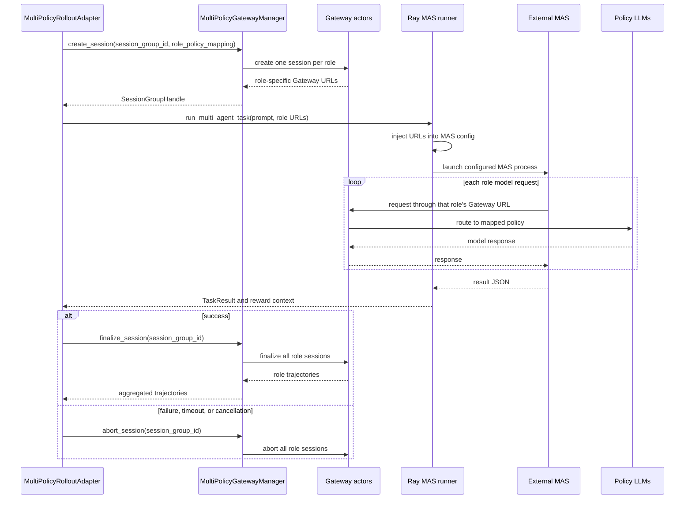

# Multi-Policy External MAS Training

This recipe trains multiple policies from rollouts produced by an external
multi-agent system (MAS). Each MAS role is routed to the policy selected by
`role_policy_mapping`; the role sessions share the rollout lifecycle, and the
resulting trajectories are scored and used by the policy trainers.

The training entry point is `examples.multi_policy.main`. The recipe builds on
Uni-Agent's Gateway and task-runner interfaces and includes a command-based
runner for launching an external MAS process.

## Requirements

- A Linux environment with Bash and the Python dependencies for this checkout,
  including its supported verl version.
- A reachable Ray cluster and the GPU resources configured for each policy's
  trainer and rollout workers.
- One model directory per configured policy, plus verl-compatible training and
  validation Parquet datasets. The checked-in YAML defines three policies;
  adding or removing policies requires updating the policy configuration,
  role mapping, and launcher overrides together.
- An external MAS application and its configuration template. The default
  `multi_policy.yaml` references `examples/multi_policy/mas_apps/search`, which
  is not included in this recipe. Replace those example paths and adapt the
  command, Gateway URL injection, role mapping, and result parsing to your MAS
  before launching.

## Configuration

The main configuration is
[`config/multi_policy.yaml`](config/multi_policy.yaml). It combines shared
training settings, one PPO configuration per policy, and the MAS/Gateway
integration. Review and adapt it before launching.

### Shared training settings

| Section | Purpose |
| --- | --- |
| `data` | Shared train and validation datasets, batch sizes, and prompt/response limits. The launcher requires `TRAIN_DATA` and `VAL_DATA` and overrides the file paths and both batch sizes. |
| `algorithm` | Shared PPO/GRPO algorithm settings, including advantage estimation and optional group filtering. |
| `trainer` | Training schedule, validation, logging, checkpoint, and resume settings. The launcher overrides total steps and the checkpoint directory. Checkpointing is disabled by default (`save_freq: -1`); set `trainer.save_freq` to a positive value to save weights. |
| `trainer.v1` | Selects the outer training mode. The launcher selects `separate_async` and supplies its parameter-sync and warmup values. |
| `transfer_queue` | Queue configuration used by `separate_async`; the example enables in-process `SimpleStorage`. |
| `ray_kwargs` | Ray initialization and worker setup. `ray_init.num_cpus: null` lets Ray detect CPUs; set a value when the cluster requires an explicit CPU count. |

The outer trainer requires `trainer.total_training_steps`. It uses that value
(multiplied by `parameter_sync_step`) as each policy's LR schedule horizon;
`trainer.total_epochs` is not used by this recipe.

For `separate_async`, keep the batch sizes consistent:

```text
train_batch_size = parameter_sync_step * ppo_mini_batch_size
```

The launcher sets `data.train_batch_size`,
`actor_rollout_ref.actor.ppo_mini_batch_size`, and
`trainer.v1.separate_async.parameter_sync_step` from environment variables and
checks this relationship before starting.

### Configuration precedence

The final configuration is composed in the following order:

1. The shared verl `ppo_trainer` configuration selected by
   `ppo_trainer_config_source` and `ppo_trainer_config_name`.
2. The checked-in `multi_policy.yaml` defaults.
3. Each policy's `ppo_trainer_overrides`, which compose the independent
   trainer configuration for that policy.
4. Environment variables processed by
   `scripts/run_external_mas_train.sh`, including model paths, resource
   values, batch sizes, rollout counts, and checkpoint paths.
5. Extra Hydra overrides passed after the launcher command. These are useful
   for one-off changes and take precedence over the launcher's defaults when
   they target the same key.

Shared settings such as `data`, `algorithm`, `trainer.v1`, and
`transfer_queue` are owned by the outer trainer. Model, actor, rollout, FSDP,
and tensor-parallel settings belong under the corresponding policy's
`ppo_trainer_overrides`. MAS routing and external-process settings belong under
`actor_rollout_ref.rollout.custom.agent_framework`.

### Per-policy PPO settings

`policies.policy_1`, `policies.policy_2`, and `policies.policy_3` each
contain a `ppo_trainer_overrides` tree. The recipe loads the shared verl
`ppo_trainer` config and applies each policy's overrides to compose its own
trainer configuration. Set each policy's model path and tune its trainer and
rollout settings independently. The example uses separate model paths and
checkpoint/NCCL names, policy-specific multi-turn formats, and GPU parallelism.

The launcher maps `POLICY_1_MODEL_PATH` through `POLICY_3_MODEL_PATH` to those
model paths. Per-policy resource variables control trainer nodes and GPUs,
FSDP size, rollout nodes and GPUs, and tensor parallel size. The FSDP size must
fit the trainer's GPU world size, and the rollout parallelism must fit the
configured rollout resources. All paths and resources must be valid and
accessible from the Ray nodes that use them.

### MAS runner and role routing

The MAS integration is configured under
`actor_rollout_ref.rollout.custom.agent_framework`:

| Key | Purpose |
| --- | --- |
| `gateway_count` | Number of Gateway actors that host policy sessions. |
| `agent_runners.multi_agent.runner_fqn` | Python entry point that binds a MAS rollout to the role Gateway endpoints and launches the configured task. |
| `dispatch_mode` | Runner dispatch strategy; the example uses `ray_task`. |
| `session_timeout_seconds` / `max_concurrent_sessions` | Bound runner duration and concurrent MAS session groups. |
| `trajectory_selection` | Selects which role trajectories are retained; the example keeps all of them. |
| `role_policy_mapping` | Maps each role name in the MAS config to a configured policy name. The role names in this mapping must match the role keys in the MAS template. |
| `mask_unfinished_episode` | Controls whether unfinished MAS episodes contribute to the policy loss. |

#### Runtime flow

For each training sample, the multi-policy adapter creates one session group
with a Gateway session for every configured role. The role-to-policy mapping
determines which policy serves each session. The adapter then invokes the
configured runner with the prompt and role-specific Gateway URLs.

With the example's `dispatch_mode: ray_task`, the runner executes through
Uni-Agent's `run_task` interface in a Ray worker. The task runner copies the
MAS config template for that rollout, injects the role Gateway URLs, and starts
the external MAS command as a local child process. The MAS application makes
its model requests to those injected URLs; each request is therefore routed to
the policy assigned to that role. After the process returns, the framework
converts the result to a task result, finalizes the role sessions, attaches the
result to their trajectories, applies reward scoring, and sends the trajectories
to training.

The training entry point follows verl v1 resource ownership: the policy
workers, Gateway actors, framework worker, and placement groups are owned by
the Ray task-runner actor and are reclaimed when that Ray owner/job exits.
Training does not perform an explicit adapter shutdown, so a long-lived Ray
driver should not assume that all GPU resources are immediately reusable after
`fit()` returns. Standalone inference should likewise let the Ray owner/job
control the adapter lifetime.

```mermaid
flowchart LR
    A[Training sample and prompt] --> B[MultiPolicyRolloutAdapter]
    B --> C[Session group: role URLs mapped to policies]
    C --> D[Runner in Ray worker]
    D --> E[Copy MAS config and inject role URLs]
    E --> F[Launch external MAS process]
    F --> G[MAS calls role Gateway URLs]
    G --> H[Parse result]
    H --> I[Finalize sessions and score trajectories]
    I --> J[Train policies]
```



The lifecycle for one rollout is shown below. A session group contains one
Gateway session per MAS role; each session is routed to the policy named by
`role_policy_mapping`. A successful runner result is finalized, while a
failure, timeout, or cancellation aborts every role session in the group.

In this recipe, one training rollout creates one session group. The framework's
unique `session_id` is passed to the multi-policy manager as the
`session_group_id`; the manager derives a separate Gateway session ID for each
role (for example, `<session_group_id>:<role>`). The group ID is therefore used
for runner inputs and group-level `finalize_session` / `abort_session` calls,
while the derived role IDs are used only for the individual Gateway actors.



### Connect an external MAS

Adapt the recipe to an existing MAS in these places:

1. **Map its roles to trainable policies.** Set
   `role_policy_mapping` to the role names used by your MAS config and the
   policy names under `policies`. Every mapped policy must have a composed PPO
   config and a model path.
2. **Point to the MAS command and config.** Set `command.work_dir` to the
   application directory, `command.argv` to its executable and arguments, and
   `config.template_path` to a YAML template that the application accepts.
   The command may use `{config_path}`, `{prompt}`, and `{session_group_id}`.
   Only these placeholders are substituted; other braces (JSON, awk, shell
   `${VAR}`) are passed through unchanged. `{gateway_url}` is rejected.
3. **Inject the role endpoints.** Set the dotted paths under
   `config.injection` to the fields the MAS reads for its model requests. The
   framework provides a distinct Gateway URL for each role; the MAS process
   must use those URLs for the matching role requests. The root-level URL is
   populated from the first role as a fallback for applications that read it.
4. **Define the result contract.** Configure `result.field_mapping` to extract
   a scalar final result and any reward context from the MAS output. The example
   expects a JSON object on stdout; update `reward.py` if your evaluator needs
   different result fields or task-specific scoring.
5. **Make runtime files reachable.** `work_dir`, the config template, command,
   and application dependencies must be present on the Ray worker that runs
   the task. Enable application-level logging as well when its diagnostics are
   not written to stdout or stderr.

The dataset must provide the prompt consumed by the runner and the ground truth
expected by the configured reward function. Optional task settings can be
provided in the sample's `tools_kwargs.task`; the runner supplies the live
session-group ID and role URLs, overriding serialized values. Keep the data
fields consistent with the scorer you configure.

The external process settings are under
`agent_runners.multi_agent.runner_kwargs`:

- `execution.backend` currently supports `local_process`.
- `command.argv` is the command and argument list used to launch the MAS.
  Command and `command.env` values can use `{config_path}`, `{prompt}`, and
  `{session_group_id}`; other braces are left unchanged. `{gateway_url}` is
  rejected because each role has its own Gateway URL. `command.work_dir` sets
  its working directory and `command.env` adds environment variables. The
  working directory, command, template, and any files they use must be
  available on the Ray worker that runs the external process.
- `config.template_path` points to the MAS YAML template. The runner copies
  this file for each rollout and injects the role Gateway URLs at the dotted
  paths configured under `config.injection`. The MAS must read these injected
  URLs for its role-specific model requests and be able to reach the Gateway
  from its execution environment.
- `timeout.seconds` limits the external process. `result` describes how to
  parse its output; the example expects a JSON object on stdout and maps its
  final result and reward fields.
- `logs.directory` optionally stores the external process stdout and stderr.

For example, this minimal template shape works with the checked-in injection
paths. The runner creates missing mappings as needed, fills the root URL with
the first role's endpoint, then writes each role's own endpoint and role name
into its entry. The checked-in example uses `agent_1`, `agent_2`, and `agent_3`
for both the MAS template and `role_policy_mapping`. Replace these names only
when your MAS uses different role keys, and update both locations together.

```yaml
agents:
  agent_1: {}
  agent_2: {}
  agent_3: {}
```

The runner creates and replaces the configured URL and model fields at runtime.
Keep each role's other application settings in its template entry; the
configured dotted paths identify only the fields the runner overwrites.

For the checked-in result mapping, the process can emit JSON such as:

```json
{
  "final_answer": "The MAS final answer",
  "approved": true
}
```

The mapping accepts `final_answer` or `final_response` as the final result
and copies `approved` into reward context. The example
[`reward.py`](reward.py) computes a score from the final answer and the
sample's ground truth; it does not treat `approved` as the score. Adapt both
the output mapping and scorer to your MAS result format and task evaluator.
The external process must exit successfully; a non-zero exit, timeout, or
invalid configured result causes that rollout to fail. For successful runs,
`logs.directory` stores stdout and stderr. Process failures include the exit
code and stderr in the runner error; MAS-specific logs should also be enabled
in the external application's own configuration when available.

### Reward and trajectory handling

`reward.custom_reward_function` selects the verl scorer, while
`reward.num_workers` sets the reward worker count per policy. The example
scorer in [`reward.py`](reward.py) reads the runner's final result and reward
context and returns flat numeric metrics. It is only a basic example; replace
it with an evaluator suitable for your task. If needed, configure
`trajectory_postprocessor_fqn` and its kwargs to process role trajectories
before reward scoring.

Gateway defaults such as tool-parser caching, assistant rollback, and allowed
request sampling parameters are shared under
`actor_rollout_ref.rollout.custom.agent_framework`. Model, tokenizer,
chat-template, and multimodal processor settings are derived from each
composed policy config.

## Launch

Set the model and dataset paths, then run the launcher from the repository root:

```bash
export POLICY_1_MODEL_PATH=/path/to/model_1
export POLICY_2_MODEL_PATH=/path/to/model_2
export POLICY_3_MODEL_PATH=/path/to/model_3
export TRAIN_DATA=/path/to/train.parquet
export VAL_DATA=/path/to/validation.parquet

bash examples/multi_policy/scripts/run_external_mas_train.sh
```

The external MAS process backend and launcher target Linux; other platforms
are not supported.

The script uses defaults for training and resource settings. Override them with
environment variables as needed; for example, `RAY_ADDRESS`,
`TOTAL_TRAINING_STEPS`, `TRAIN_BATCH_SIZE`, `ROLLOUT_N`, and the
`POLICY_{1,2,3}_*` resource variables. The configuration section above
describes the batch-size constraint and per-policy resource settings.

Additional Hydra overrides can be passed as arguments to the launcher:

```bash
bash examples/multi_policy/scripts/run_external_mas_train.sh \
  trainer.test_freq=10
```

Checkpointing is disabled by default (`trainer.save_freq: -1`); training runs
normally but writes no weights. To enable it, pass a positive interval:

```bash
bash examples/multi_policy/scripts/run_external_mas_train.sh \
  trainer.save_freq=50
```

A positive `save_freq` always saves the final step. `CKPT_DIR` sets
`trainer.default_local_dir` and is used only when checkpointing is enabled.
Logs go under `examples/multi_policy/logs`; checkpoints, when enabled, go under
`checkpoints/multi_policy`. Set `LOG_PATH` or `CKPT_DIR` to change these.

## Validation

Run the CPU recipe tests from the repository root before opening a PR:

```bash
pytest -q -m "cpu and level0" tests/uni_agent/multi_policy
```

The focused runner and lifecycle tests can be run independently while
developing changes to the external MAS path:

```bash
pytest -q tests/uni_agent/multi_policy/test_task_runner.py \
  tests/uni_agent/multi_policy/test_reward_contract.py \
  tests/uni_agent/multi_policy/test_multi_agent_gateway_manager.py \
  tests/uni_agent/multi_policy/test_framework_lifecycle.py
```

These tests validate configuration composition, role-to-policy routing,
session-group finalization and abort behavior, external-process result
normalization, and reward propagation. They do not start a real external MAS,
load model weights, or prove that a Ray cluster has enough GPU capacity.

A Ray/GPU integration check is required before production use. Run it with
real policy checkpoints, a reachable external MAS application, and the exact
command shown in the Launch section. Verify that at least one rollout
completes, each role reaches its mapped policy, the external process returns
valid JSON, and trajectories appear in the transfer queue. Checkpoint writing
is disabled by default; if it is part of your check, add
`trainer.save_freq=50` (or another positive value) to the launch command and
verify that a checkpoint directory is written. This integration check requires
Linux, Bash, Ray, and the configured GPU resources; it cannot be replaced by
the CPU tests.
