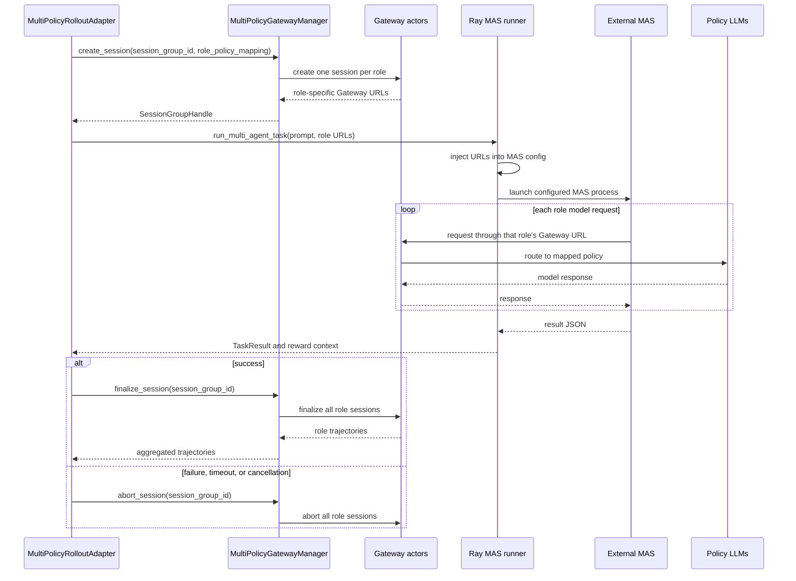

# Multi-Policy External MAS Training

This recipe trains multiple policies from rollouts produced by an external
multi-agent system (MAS). Each MAS role is routed to the policy selected by
`role_policy_mapping`; the role sessions share the rollout lifecycle, and the
resulting trajectories are scored and used by the policy trainers.

The training entry point is `examples.multi_policy.main`. The recipe builds on
Uni-Agent's Gateway and task-runner interfaces and includes a command-based
runner for launching an external MAS process.

The recipe constructs its rollout adapter directly from `MultiPolicyTaskRunner`:
`MultiPolicyRolloutAdapter` needs the per-policy LLM clients and composed policy
configs owned by `MultiPolicyTrainer`, which the standard verl `TaskRunner`
cannot supply. It therefore does not use
`actor_rollout_ref.rollout.agent.agent_loop_manager_class`; launch the recipe
through `examples.multi_policy.main`, not `verl.trainer.main_ppo`.

## Requirements

- A Linux environment with Bash and the Python dependencies for this checkout,
  including its supported verl version. See the
  [installation guide](../../docs/source/quickstart/installation.md).
- A reachable Ray cluster and the GPU resources configured for each policy's
  trainer and rollout workers.
- One model directory per configured policy, plus verl-compatible training and
  validation Parquet datasets. The checked-in YAML defines three policies;
  adding or removing policies requires updating the policy configuration,
  role mapping, and launcher overrides together.
- An external MAS application and its configuration template. The checked-in
  `multi_policy.yaml` points `task_config_path` at
  [`external_mas/task_config.yaml`](external_mas/task_config.yaml), which owns
  the app-specific command, paths, Gateway injection, result mapping, timeout,
  and logs. Edit that recipe-local file when the checkout lives elsewhere, and
  adapt the role mapping and result contract to your MAS before launching. The
  checked-in settings target the reference Search MAS at
  [`zehanzhu/search_mas_app`](https://github.com/zehanzhu/search_mas_app),
  which is not part of this repository and also provides the training and
  validation Parquet files.

## Configuration

The main configuration is
[`config/multi_policy.yaml`](config/multi_policy.yaml). It combines shared
training settings, one PPO configuration per policy, and the MAS/Gateway
integration. Review and adapt it before launching.

### Shared training settings

| Section | Purpose |
| --- | --- |
| `data` | Shared train and validation datasets, batch sizes, and prompt/response limits. The launcher defaults `TRAIN_DATA` and `VAL_DATA` under `$HOME` and overrides the file paths and both batch sizes. |
| `algorithm` | Shared PPO/GRPO algorithm settings, including advantage estimation and optional group filtering. |
| `trainer` | Training schedule, validation, logging, checkpoint, and resume settings. The launcher overrides total steps and the checkpoint directory. Checkpointing is disabled by default (`save_freq: -1`); set `trainer.save_freq` to a positive value to save weights. |
| `trainer.v1` | Selects the outer training mode. The launcher selects `separate_async` and supplies its parameter-sync and warmup values. |
| `transfer_queue` | Queue configuration used by `separate_async`; the example enables in-process `SimpleStorage`. |
| `ray_kwargs` | Ray initialization and worker setup. `ray_init.num_cpus: null` lets Ray detect CPUs; set a value when the cluster requires an explicit CPU count. |

The outer trainer requires `trainer.total_training_steps`. It uses that value
(multiplied by `parameter_sync_step`) as each policy's LR schedule horizon;
`trainer.total_epochs` is not used by this recipe.

For `separate_async`, keep the batch sizes consistent:

```text
train_batch_size = parameter_sync_step * ppo_mini_batch_size
```

The launcher sets `data.train_batch_size`,
`actor_rollout_ref.actor.ppo_mini_batch_size`, and
`trainer.v1.separate_async.parameter_sync_step` from environment variables and
checks this relationship before starting.

### Configuration precedence

The final configuration is composed in the following order:

1. The shared verl `ppo_trainer` configuration selected by
   `ppo_trainer_config_source` and `ppo_trainer_config_name`.
2. The checked-in `multi_policy.yaml` defaults.
3. Each policy's `ppo_trainer_overrides`, which compose the independent
   trainer configuration for that policy.
4. Environment variables processed by
   `run_train.sh`, including model paths, resource
   values, batch sizes, rollout counts, and checkpoint paths.
5. Extra Hydra overrides passed after the launcher command. These are useful
   for one-off changes and take precedence over the launcher's defaults when
   they target the same key.

Shared settings such as `data`, `algorithm`, `trainer.v1`, and
`transfer_queue` are owned by the outer trainer. Model, actor, rollout, FSDP,
and tensor-parallel settings belong under the corresponding policy's
`ppo_trainer_overrides`. MAS routing and external-process settings belong under
`actor_rollout_ref.rollout.custom.agent_framework`.

### Per-policy PPO settings

`policies.policy_1`, `policies.policy_2`, and `policies.policy_3` each
contain a `ppo_trainer_overrides` tree. The recipe loads the shared verl
`ppo_trainer` config and applies each policy's overrides to compose its own
trainer configuration. Set each policy's model path and tune its trainer and
rollout settings independently. The example uses distinct checkpoint/NCCL names,
policy-specific multi-turn formats, and GPU parallelism; the launcher defaults
all three model paths to the same Qwen3-4B checkpoint, so override
`POLICY_{1,2,3}_MODEL_PATH` to train from different checkpoints.

The launcher maps `POLICY_1_MODEL_PATH` through `POLICY_3_MODEL_PATH` to those
model paths. Per-policy resource variables control trainer nodes and GPUs,
FSDP size, rollout nodes and GPUs, and tensor parallel size. The launcher
defaults request 24 GPUs: one trainer node with 4 GPUs per policy (3 × 4) plus
3/2/1 rollout nodes with 2 GPUs each (6 × 2). Override the `POLICY_{1,2,3}_*`
variables to match your cluster. The FSDP size must fit the trainer's GPU world
size, and the rollout parallelism must fit the configured rollout resources. All
paths and resources must be valid and accessible from the Ray nodes that use
them.

### MAS runner and role routing

The MAS integration is configured under
`actor_rollout_ref.rollout.custom.agent_framework`:

| Key | Purpose |
| --- | --- |
| `gateway_count` | Number of Gateway actors that host policy sessions. |
| `log_dir` | Writes per-session framework/task logs and successful per-role trajectory dumps. |
| `agent_runners.multi_agent.runner_fqn` | Python entry point that binds a MAS rollout to the role Gateway endpoints and launches the configured task. |
| `dispatch_mode` | Runner dispatch strategy; the example uses `ray_task`. |
| `session_timeout_seconds` / `max_concurrent_sessions` | Bound runner duration and concurrent MAS session groups. |
| `trajectory_selection` | Selects which role trajectories are retained; the example keeps all of them. |
| `role_policy_mapping` | Maps each role name in the MAS config to a configured policy name. The role names in this mapping must match the role keys in the MAS template. |
| `mask_unfinished_episode` | Controls whether unfinished MAS episodes contribute to the policy loss. |

#### Runtime flow

For each training sample, the multi-policy adapter creates one session group
with a Gateway session for every configured role. The role-to-policy mapping
determines which policy serves each session. The adapter then invokes the
configured runner with the prompt and role-specific Gateway URLs.

With the example's `dispatch_mode: ray_task`, the runner executes through
Uni-Agent's `run_task` interface in a Ray worker. The task runner copies the
MAS config template for that rollout, injects the role Gateway URLs, and starts
the external MAS command as a local child process. The MAS application makes
its model requests to those injected URLs; each request is therefore routed to
the policy assigned to that role. After the process returns, the framework
converts the result to a task result, finalizes the role sessions, attaches the
result to their trajectories, applies reward scoring, and sends the trajectories
to training.

The training entry point follows verl v1 resource ownership: the policy
workers, Gateway actors, framework worker, and placement groups are owned by
the Ray task-runner actor and are reclaimed when that Ray owner/job exits.
Training does not perform an explicit adapter shutdown, so a long-lived Ray
driver should not assume that all GPU resources are immediately reusable after
`fit()` returns. Standalone inference should likewise let the Ray owner/job
control the adapter lifetime.

The code separates generic multi-role wiring from the example MAS:

- [`framework/multi_agent_runner.py`](framework/multi_agent_runner.py) is the
  generic runner. It requires the sample to carry `tools_kwargs.task` (a
  serialized Task Config with a registry `name`), injects the live group ID and
  role URLs, and delegates to Uni-Agent's `run_task`.
- [`external_mas/task.py`](external_mas/task.py) registers
  `multi_policy_external_mas` and composes process execution with
  `compute_score` imported from `reward.py`.
- [`external_mas/reward.py`](external_mas/reward.py) implements `compute_score`
  and the answer normalization used by that Task.
- [`external_mas/dataset.py`](external_mas/dataset.py) writes normalized answers
  to the Task Config and forwards metadata for fallback/diagnostics.
- [`external_mas/task_config.yaml`](external_mas/task_config.yaml) is the
  recipe-local Task/runner config: command, paths, injection, result mapping,
  timeout, and logs.
- [`external_mas/execution.py`](external_mas/execution.py) launches the
  external process, injects Gateway config, and parses stdout.
- [`external_mas/process_backend.py`](external_mas/process_backend.py) owns
  local subprocess execution, timeout, and process-group cleanup.
- [`external_mas/runner.py`](external_mas/runner.py) is the `runner_fqn` entry
  point; importing it registers the Task.

Other MAS apps can reuse the generic runner and add their own Task class,
evaluator module, dataset adapter, and result mapping under a new recipe
package. Each task keeps a single Task class with a direct evaluator import.

```mermaid
flowchart LR
    A[Training sample and prompt] --> B[MultiPolicyRolloutAdapter]
    B --> C[Session group: role URLs mapped to policies]
    C --> D[Runner in Ray worker]
    D --> E[Copy MAS config and inject role URLs]
    E --> F[Launch external MAS process]
    F --> G[MAS calls role Gateway URLs]
    G --> H[Parse result]
    H --> I[Finalize sessions and score trajectories]
    I --> J[Train policies]
```



The lifecycle for one rollout is shown below. A session group contains one
Gateway session per MAS role; each session is routed to the policy named by
`role_policy_mapping`. A successful runner result is finalized, while a
failure, timeout, or cancellation aborts every role session in the group.

In this recipe, one training rollout creates one session group. The framework's
unique `session_id` is passed to the multi-policy manager as the
`session_group_id`; the manager derives a separate Gateway session ID for each
role (for example, `<session_group_id>:<role>`). The group ID is therefore used
for runner inputs and group-level `finalize_session` / `abort_session` calls,
while the derived role IDs are used only for the individual Gateway actors.



### Connect an external MAS

Adapt the recipe to an existing MAS in these places:

1. **Map its roles to trainable policies.** Set
   `role_policy_mapping` to the role names used by your MAS config and the
   policy names under `policies`. Every mapped policy must have a composed PPO
   config and a model path.
2. **Point to the MAS command and config.** In
   [`external_mas/task_config.yaml`](external_mas/task_config.yaml), set
   `launcher_kwargs.command.work_dir` to the application directory,
   `launcher_kwargs.command.argv` to its executable and arguments, and
   `launcher_kwargs.config.template_path` to a YAML template that the
   application accepts. The command may use `{config_path}`, `{prompt}`, and
   `{session_group_id}`. Only these placeholders are substituted; other braces
   (JSON, awk, shell `${VAR}`) are passed through unchanged. `{gateway_url}` is
   rejected.
3. **Inject the role endpoints.** Set the dotted paths under
   `launcher_kwargs.config.injection` in the Task Config to the fields the MAS
   reads for its model requests. The
   framework provides a distinct Gateway URL for each role; the MAS process
   must use those URLs for the matching role requests. The root-level URL is
   populated from the first role as a fallback for applications that read it.
4. **Define the result contract.** Configure `result.field_mapping` to extract
   a scalar final result and any reward context from the MAS output. The example
   expects a JSON object on stdout and maps `final_answer`/`final_response`
   plus `approved` into the reward context. `ExternalMASTask` extracts the
   final answer, resolves the sample ground truth, and imports `compute_score`
   directly from `external_mas/reward.py`. A MAS app with different result
   fields or correctness rules should define its own Task class and evaluator
   module.
5. **Make runtime files reachable.** `work_dir`, the config template, command,
   and application dependencies must be present on the Ray worker that runs
   the task. Enable application-level logging as well when its diagnostics are
   not written to stdout or stderr.

#### Reference application

The checked-in settings target the Search MAS reference implementation at
[`zehanzhu/search_mas_app`](https://github.com/zehanzhu/search_mas_app), which
is maintained outside this repository and bundles the MAS code, the dataset, and
the retrieval-service scripts. Its README covers dependency installation,
retrieval setup, and the agent flow. Clone it:

```bash
git clone https://github.com/zehanzhu/search_mas_app.git
```

**Task Config.** Point these fields at the checkout:

- `launcher_kwargs.command.work_dir` → the cloned `search_mas_app` directory
- `launcher_kwargs.config.template_path` → `search_mas_app/configs/inference.yaml`

**Retrieval service.** Deploy it on separate machine resources from the training
system; do not colocate it with the policy trainers or rollout workers. The
external MAS process runs on a Ray worker, so the service must be reachable from
every node that can host the task. The template defaults to
`http://127.0.0.1:8010/retrieve`; set `SEARCH_MAS_RETRIEVAL_SERVICE_URL` under
`launcher_kwargs.command.env` in the Task Config to the retrieval host's
address. The reference README covers the service's environment and startup.

**Dataset.** Training and validation data must be verl-style Parquet with
`prompt` and `reward_model.ground_truth` columns. The reference repository
bundles both files: `train.parquet` (169,615 NQ + HotpotQA rows) and
`test_sampled.parquet` (210 rows sampled from seven evaluation sets). Point
`TRAIN_DATA` and `VAL_DATA` at them. They also carry
`extra_info.ground_truth_raw.target`, which `ExternalMASTask` prefers because
`reward_model.ground_truth` can contain concatenated answer strings. The data
derives from Search-R1's
[`PeterJinGo/nq_hotpotqa_train`](https://huggingface.co/datasets/PeterJinGo/nq_hotpotqa_train);
use Search-R1's
[`nq_search.py`](https://github.com/PeterGriffinJin/Search-R1/blob/main/scripts/data_process/nq_search.py)
to regenerate it.

The reference application follows the contract described above; its README
documents its role names and result fields. Any application that satisfies the
same requirements can replace it; the link is a convenience, not a dependency of
the recipe.

For a custom dataset, provide the prompt consumed by the runner and the ground
truth expected by the reward function. Optional task settings go under
`tools_kwargs.task`; the runner overrides the serialized session-group ID and
role URLs with live values.

The checked-in [`MultiPolicyDataset`](external_mas/dataset.py) (configured via
`data.custom_cls`) writes the normalized answers to
`tools_kwargs.task.ground_truth` and also copies `reward_model` and
`extra_info.ground_truth_raw` into `tools_kwargs.task.metadata` as a fallback.
`extract_expected_answers` prefers `ground_truth_raw.target` when present,
because some datasets encode multiple answers as one concatenated string in
`reward_model.ground_truth`. If you override `data.custom_cls`, replicate that
forwarding; otherwise `ExternalMASTask` cannot access the ground truth.

`agent_runners.multi_agent.runner_kwargs.task_config_path` points at
[`external_mas/task_config.yaml`](external_mas/task_config.yaml). The external
process settings are under that file's `launcher_kwargs`:

- `execution.backend` currently supports `local_process`.
- `command.argv` is the command and argument list used to launch the MAS.
  Command and `command.env` values can use `{config_path}`, `{prompt}`, and
  `{session_group_id}`; other braces are left unchanged. `{gateway_url}` is
  rejected because each role has its own Gateway URL. `command.work_dir` sets
  its working directory and `command.env` adds environment variables. The
  working directory, command, template, and any files they use must be
  available on the Ray worker that runs the external process.
- `config.template_path` points to the MAS YAML template. The runner copies
  this file for each rollout and injects the role Gateway URLs at the dotted
  paths configured under `config.injection`. The MAS must read these injected
  URLs for its role-specific model requests and be able to reach the Gateway
  from its execution environment.
- `timeout.seconds` limits the external process. `result` describes how to
  parse its output; the example expects a JSON object on stdout and maps its
  final result and reward fields.
- `logs.directory` stores each rollout's external-process stdout and stderr.
  Both successful and failed runs are written; timeout logs contain whatever
  output was drained before termination.

For example, this minimal template shape works with the checked-in injection
paths. The runner creates missing mappings as needed, fills the root URL with
the first role's endpoint, then writes each role's own endpoint and role name
into its entry. The example config targets the Search MAS, whose template uses
`verifier`, `searcher`, and `answerer`. These names must match
`role_policy_mapping`, which maps them to `policy_1`, `policy_2`, and
`policy_3` respectively:

```yaml
agents:
  verifier: {}
  searcher: {}
  answerer: {}

role_policy_mapping:
  verifier: policy_1
  searcher: policy_2
  answerer: policy_3
```

Replace these names only when your MAS uses different role keys, and update
both locations together.

The runner creates and replaces the configured URL and model fields at runtime.
Keep each role's other application settings in its template entry; the
configured dotted paths identify only the fields the runner overwrites.

For the checked-in result mapping, the process can emit JSON such as:

```json
{
  "final_answer": "The MAS final answer",
  "approved": true
}
```

The mapping accepts `final_answer` or `final_response` as the final result
and copies `approved`, `final_answer`, and `final_response` into reward
context. `approved` is an application routing flag, not answer correctness.
`ExternalMASTask` extracts `final_answer` (falling back to an `<answer>` tag in
`final_response`, then `final_result`) and passes it with the sample's
`ground_truth` to `compute_score` in [`reward.py`](external_mas/reward.py).
The scorer performs a normalized exact match and never substring-matches the
full response.
The external process must exit successfully; a non-zero exit, timeout, or
invalid configured result causes that rollout to fail. `logs.directory` stores
stdout and stderr for successful, non-zero-exit, and timeout runs, so failures
retain the external MAS diagnostics. Process failures also include the exit
code and stderr in the runner error; MAS-specific logs should be enabled in the
external application's own configuration when available.

### Reward and trajectory handling

`reward.custom_reward_function` selects the verl reward callback, while
`reward.num_workers` sets the reward worker count per policy. The recipe
configures the callback as two fields:

```yaml
reward:
  custom_reward_function:
    path: pkg://uni_agent.framework.task_runner
    name: score_from_runner_result
```

`score_from_runner_result` simply forwards the `TaskResult` produced by
`ExternalMASTask`; the path must name the module and the name must name the
callable, so do not combine them into a `module:function` string. The pure
`compute_score(final_answer, ground_truths)` function in
[`reward.py`](external_mas/reward.py) normalizes case, articles, text
punctuation, whitespace, and accents before exact matching. Punctuation with
numeric meaning is preserved, so `3.5` does not match `35`, `-6` does not match
`6`, and `2017/18` does not match `201718`. `ExternalMASTask` sets both
`reward` and `accuracy` to its result. Replace the scorer together with the
Task for another MAS app. If needed, configure `trajectory_postprocessor_fqn`
and its kwargs to process role trajectories before reward scoring.

Gateway defaults such as tool-parser caching, assistant rollback, and allowed
request sampling parameters are shared under
`actor_rollout_ref.rollout.custom.agent_framework`. Model, tokenizer,
chat-template, and multimodal processor settings are derived from each
composed policy config.

### Launcher environment variables

`run_train.sh` reads the environment variables below; the defaults are the
checked-in example values. Any value can be overridden, and additional Hydra
overrides can be appended after the command (see [Launch](#launch)).

**Training and rollout.**

| Variable | Default | Purpose |
| --- | --- | --- |
| `RAY_ADDRESS` | `auto` | Ray cluster address. |
| `TOTAL_TRAINING_STEPS` | `100` | Outer-trainer steps. |
| `TRAIN_BATCH_SIZE` | `64` | Must equal `PARAMETER_SYNC_STEP × PPO_MINI_BATCH_SIZE`. |
| `PARAMETER_SYNC_STEP` | `2` | Batches consumed per parameter sync. |
| `PPO_MINI_BATCH_SIZE` | `TRAIN_BATCH_SIZE / PARAMETER_SYNC_STEP` | Per-policy mini-batch size. |
| `ROLLOUT_N` | `8` | GRPO rollouts per prompt. |
| `NUM_WARMUP_BATCHES` | `8` | Batches pre-filled into the transfer queue. |
| `MAX_CONCURRENT_SESSIONS` | `128` | Concurrent MAS session groups. |
| `PROMPT_LENGTH` / `RESPONSE_LENGTH` | `16384` / `1024` | Sequence limits. |
| `MAX_MODEL_LEN` | `PROMPT_LENGTH + RESPONSE_LENGTH + 512` | vLLM context length. |

**Paths and logging.**

| Variable | Default | Purpose |
| --- | --- | --- |
| `POLICY_{1,2,3}_MODEL_PATH` | `${HOME}/models/Qwen3-4B` | Model directory per policy. |
| `TRAIN_DATA` / `VAL_DATA` | `${HOME}/data/multi_policy/{train,val}.parquet` | Parquet datasets. |
| `TASK_CONFIG` | `examples/multi_policy/external_mas/task_config.yaml` | Task Config passed to the runner. |
| `AGENT_LOG_DIR` | `examples/multi_policy/logs/agent_logs` | Per-session framework/task logs. |
| `VERL_FILE_LOGGER_ROOT` | `examples/multi_policy/metrics` | Metrics root (`<project>/<experiment>.jsonl`). |
| `LOG_DIR` / `LOG_PATH` | `examples/multi_policy/logs` / `<LOG_DIR>/external_mas_<ts>.log` | Launcher log. |
| `CKPT_DIR` | `checkpoints/multi_policy/external_mas_<ts>` | Checkpoint directory used when `save_freq > 0`. |
| `EXPERIMENT_NAME` | `search_mas_<ts>` | Experiment name. |

**Per-policy resources.**

| Variable | Defaults (`policy_1/2/3`) | Purpose |
| --- | --- | --- |
| `POLICY_{1,2,3}_NNODES` | `1 / 1 / 1` | Trainer nodes. |
| `POLICY_{1,2,3}_N_GPUS_PER_NODE` | `4 / 4 / 4` | Trainer GPUs per node. |
| `POLICY_{1,2,3}_FSDP_SIZE` | `4 / 4 / 4` | FSDP size; must divide the trainer world size. |
| `POLICY_{1,2,3}_ROLLOUT_NNODES` | `3 / 2 / 1` | Rollout nodes. |
| `POLICY_{1,2,3}_ROLLOUT_N_GPUS_PER_NODE` | `2 / 2 / 2` | Rollout GPUs per node. |
| `POLICY_{1,2,3}_TENSOR_PARALLEL_SIZE` | `2 / 2 / 2` | vLLM tensor-parallel size. |

Path overrides for `TASK_CONFIG`, `AGENT_LOG_DIR`, and `VERL_FILE_LOGGER_ROOT`
must be absolute; they are resolved on Ray workers whose working directory may
differ from the repository root.

`NCCL_DEBUG`, `NCCL_P2P_DISABLE`, `NCCL_SHM_DISABLE`, and `HYDRA_FULL_ERROR` are
also exported by the launcher with defaults and can be overridden the same way.

## Launch

Deploy the retrieval service on its own machine resources and make it reachable
from the Ray workers; the [reference application](#reference-application) README
covers its setup. Then clone the reference application, point
`external_mas/task_config.yaml` at the checkout, and set the model and dataset
paths and run the launcher from the repository root:

```bash
git clone https://github.com/zehanzhu/search_mas_app.git /path/to/search_mas_app

export POLICY_1_MODEL_PATH=/path/to/model_1
export POLICY_2_MODEL_PATH=/path/to/model_2
export POLICY_3_MODEL_PATH=/path/to/model_3
export TRAIN_DATA=/path/to/search_mas_app/train.parquet
export VAL_DATA=/path/to/search_mas_app/test_sampled.parquet

bash examples/multi_policy/run_train.sh
```

For a smoke test, reduce the run length before the full training run:

```bash
TOTAL_TRAINING_STEPS=5 bash examples/multi_policy/run_train.sh
```

The launcher prints the metrics file path; see [Monitoring](#monitoring) for the
log and metrics layout.

The external MAS process backend and launcher target Linux; other platforms
are not supported.

The script uses defaults for training and resource settings; see
[Launcher environment variables](#launcher-environment-variables) for the full
list. The configuration section above describes the batch-size constraint and
per-policy resource settings.

Additional Hydra overrides can be passed as arguments to the launcher:

```bash
bash examples/multi_policy/run_train.sh \
  trainer.test_freq=10
```

Checkpointing is disabled by default (`trainer.save_freq: -1`); training runs
normally but writes no weights. To enable it, pass a positive interval:

```bash
bash examples/multi_policy/run_train.sh \
  trainer.save_freq=50
```

A positive `save_freq` always saves the final step. `CKPT_DIR` sets
`trainer.default_local_dir` and is used only when checkpointing is enabled.
Logs go under `examples/multi_policy/logs`; checkpoints, when enabled, go under
`checkpoints/multi_policy`. Set `LOG_PATH` or `CKPT_DIR` to change these.

## Monitoring

- **Launcher log.** The path is printed at startup and written to
  `examples/multi_policy/logs/external_mas_<timestamp>.log`.
- **Agent and task logs.** Per-session framework/task logs and successful
  trajectory dumps are written under `AGENT_LOG_DIR`
  (`examples/multi_policy/logs/agent_logs`).
- **External process logs.** Each rollout's stdout/stderr is stored under the
  Task Config's `logs.directory` (`examples/multi_policy/logs/external_mas`),
  including failed and timed-out runs.
- **Metrics.** The verl file logger writes
  `VERL_FILE_LOGGER_ROOT/marl/<experiment>.jsonl`; each line is
  `{"step": ..., "data": {...}}` with per-policy entries such as
  `policy_1/actor/loss` plus the reward and accuracy values.
- **Validation.** `trainer.test_freq` controls how often validation runs
  (default every 5 steps); `val_before_train` is disabled in the checked-in
  config.

## Validation

Run the CPU recipe tests from the repository root before opening a PR:

```bash
pytest -q -m "cpu and level0" tests/uni_agent/multi_policy
```

The focused runner and lifecycle tests can be run independently while
developing changes to the external MAS path:

```bash
pytest -q tests/uni_agent/multi_policy/test_external_mas_task.py \
  tests/uni_agent/multi_policy/test_reward_contract.py \
  tests/uni_agent/multi_policy/test_multi_agent_gateway_manager.py \
  tests/uni_agent/multi_policy/test_framework_lifecycle.py
```

These tests validate configuration composition, role-to-policy routing,
session-group finalization and abort behavior, external-process result
normalization, and reward propagation. They do not start a real external MAS,
load model weights, or prove that a Ray cluster has enough GPU capacity.

A Ray/GPU integration check is required before production use. Run it with
real policy checkpoints, a reachable external MAS application, and the exact
command shown in the Launch section. Verify that at least one rollout
completes, each role reaches its mapped policy, the external process returns
valid JSON, and trajectories appear in the transfer queue. Checkpoint writing
is disabled by default; if it is part of your check, add
`trainer.save_freq=50` (or another positive value) to the launch command and
verify that a checkpoint directory is written. This integration check requires
Linux, Bash, Ray, and the configured GPU resources; it cannot be replaced by
the CPU tests.

## Troubleshooting

- **The external process cannot reach the retrieval service.** The MAS process
  runs on a Ray worker, so `127.0.0.1` only reaches services on that node. Set
  `SEARCH_MAS_RETRIEVAL_SERVICE_URL` under `launcher_kwargs.command.env` in the
  Task Config to an address reachable from the workers.
- **Role URLs or models are not injected.** The keys in `role_policy_mapping`
  must match the agent keys in the MAS config template. The runner creates
  missing entries, but renaming a role in only one place silently drops its
  endpoint binding.
- **The external command cannot find its files.** `command.work_dir` and
  `config.template_path` must exist on the Ray worker that runs the task; the
  checked-in values are placeholders. The command, interpreter, and application
  dependencies must be available there too.
- **A rollout fails with a non-zero exit, timeout, or invalid JSON.** Check the
  file under the Task Config's `logs.directory`; the runner includes the exit
  code and stderr in the error. The process must exit 0 and print a JSON object
  on stdout.
- **The launcher rejects the batch sizes.** `TRAIN_BATCH_SIZE` must equal
  `PARAMETER_SYNC_STEP × PPO_MINI_BATCH_SIZE`; the script checks this before
  starting.
- **Resource errors.** `FSDP_SIZE` must divide `NNODES × N_GPUS_PER_NODE`, and
  `TENSOR_PARALLEL_SIZE` must divide `ROLLOUT_NNODES ×
  ROLLOUT_N_GPUS_PER_NODE`. The default topology requests 24 GPUs.
- **The dataset fails to load or rewards are empty.** Training requires
  verl-style Parquet with `prompt` and `reward_model.ground_truth` columns; the
  reference repository ships a compatible pair.
