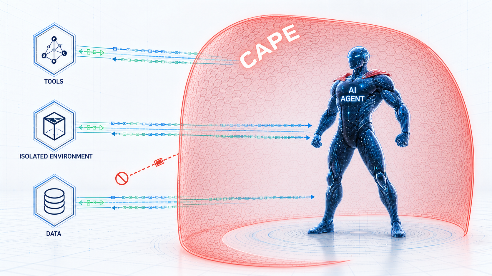

<p align="center">
  <picture>
    <source
      media="(prefers-color-scheme: dark)"
      srcset="./images/dark-cape.png">
    <source
      media="(prefers-color-scheme: light)"
      srcset="./images/light-cape.png">
    
  </picture>
</p>

# CAPE — Container-Aware Placement Engine

**A lease-based local-pool scheduler for transparent containerized workload execution.**

CAPE lets multiple users share a pool of already-allocated GPU/CPU nodes and run their **unchanged**
commands inside isolated containers. A shared HTTP control plane accepts asynchronous submissions,
node agents contribute the real hardware, and pluggable runtime adapters (Apptainer, Bubblewrap,
Podman, or a plain local process) launch each command. Pools declare either **exclusive** GPU
leasing or **shared** co-location with K slots per GPU. One physical-UUID ledger arbitrates both
views, and every lease is released when the workload's process tree exits — an idle warm session
keeps its filesystem state but never pins a GPU.

It implements the accepted "scheduler → container → real workloads" design (a shared central control
plane, dynamic node-agent pool injection, session-scoped leases, and capability-probing runtime
adapters).

CAPE ships **two interoperable implementations** of the same wire protocol and CLI: **`rscape`**
(Rust, the default) and **`pycape`** (Python). See [Implementations](#implementations).

> **Naming.** The project directory is `cape/`. `rscape/` builds the `rscape` binary; `pycape/` is
> the importable Python package and installs a `pycape` console script. There is no executable
> named `cape` — that is the project, not a command.

---

## Table of contents

- [Why CAPE](#why-cape)
- [Implementations](#implementations)
- [Installation](#installation)
- [Concepts](#concepts)
- [Architecture](#architecture)
- [Quick start (CLI)](#quick-start-cli)
- [CLI reference](#cli-reference)
- [HTTP API reference](#http-api-reference)
- [Runtime adapters & isolation policies](#runtime-adapters--isolation-policies)
- [Image-backed workspaces](#image-backed-workspaces)
- [GPU lease lifecycle (cached-idle)](#gpu-lease-lifecycle-cached-idle)
- [Session reuse rules](#session-reuse-rules)
- [Authentication & authorization](#authentication--authorization)
- [Persistent identities and ownership](./docs/identity.md)
- [Scheduling, queueing & quotas](#scheduling-queueing--quotas)
- [State model](#state-model)
- [Persistence & recovery](#persistence--recovery)
- [Observability](#observability)
- [Environment profiles](#environment-profiles)
- [Configuration reference](#configuration-reference)
- [Testing](#testing)
- [Mimic & validation](#mimic--validation)
- [V0 scope & limitations](#v0-scope--limitations)
- [Python (library) API](#python-library-api)

---

## Why CAPE

- **Transparent to workloads.** Users keep the same executable, arguments, working directory, data
  paths, and output paths. The platform only needs metadata (image/profile, GPU count, mounts, time
  limit, isolation policy). No rewriting to a task/actor API.
- **Work-conserving physical-GPU leasing.** Every physical GPU UUID is either free, held by one
  exclusive session, or shared by at most K co-located sessions. Pool views cannot double-lease
  the same hardware, and cached sessions reacquire slots only while a command runs.
- **Warm sessions without GPU hoarding.** Session/cache lifetime is decoupled from GPU-lease
  lifetime, so a cached-idle session amortizes container/image/env setup while its GPU returns to the
  pool.
- **Image-backed command workspaces.** Every new session gets a managed ext4/fuse2fs workspace.
  Files created inside it occupy internal image inodes, keeping the host backing-file inventory
  bounded instead of creating one host inode per user file. Python and native Rust both support it.
- **Non-root, nested-friendly.** No rootful daemon or root privileges are assumed; adapters probe
  their real capabilities and advertise only what they can prove on the node.
- **Asynchronous by construction.** Submissions return a durable request id immediately; callers
  poll, wait, cancel, or stream logs.

---

## Implementations

Two implementations speak the same HTTP wire protocol, share one journal format, and expose the
same command-line surface. They interoperate in every direction: either can serve as controller,
node agent, or submitter against the other, and either can replay the other's journal.

| | `rscape` | `pycape` |
| --- | --- | --- |
| Language | Rust (static PIE) | Python ≥ 3.8 |
| Role | **Default** for all script-driven suites | Maintained, explicitly selectable |
| Surface | **CLI only** — no library API | CLI, HTTP service, and an in-process Python API |
| Startup | ~9.5 ms | ~240 ms (interpreter + imports) |
| Language runtime dependencies | none | `aiohttp>=3.8` |

Both implementations require external filesystem tools on execution nodes for managed workspaces,
in addition to any selected container runtime; see [node prerequisites](#workspace-node-prerequisites).

`rscape` exists because the dominant client-side cost is per-invocation interpreter and import
startup, not scheduling. Since every CLI call is a short-lived process, removing that chain is what
moves the number — a real-rollout pooled submission lag measured p50 88 ms against a 10.4-second
Python baseline. Treat those as environment-specific; the durable conclusion is the shape, not the
constant.

**Neither implementation is deprecated.** `CAPE_BIN`, `CAPE_NODE_BIN`, `CAPE_SUBMIT_BIN`,
`CAPE_STATUS_BIN`, and `CAPE_RETIRE_BIN` each select per role and default to `rscape`; a bare
`pycape` engages the Python bootstrap, and an explicit path bypasses installation entirely. A
missing `rscape` is fatal and never silently falls back.

`rscape` deliberately exposes **no in-process or library API**. Parity is proven through the CLI and
the journal — see [Testing](#testing) for the bidirectional conformance gate.

---

## Installation

### `rscape` (default)

From a Linux checkout, install the current source and node prerequisites with:

```bash
cd cape
bash install.sh
export PATH="$HOME/.local/bin:$PATH"
```

Every normal invocation builds the current checkout using `cargo build --release --locked`
and installs the result, even if rscape is already present. Cargo may reuse unchanged build
artifacts. Existing usable Rust and dependency tools are reused; missing system packages
require root/sudo and confirmation. Automatic package installation supports Ubuntu/Debian.
On Ubuntu, adding the official Apptainer PPA requires a separate confirmation or explicit
`--allow-apptainer-ppa`; `--yes` alone does not authorize a new package source. Debian users
without an Apptainer repository candidate must provision the official package and rerun.

```bash
bash install.sh --check                # read-only prerequisites check; no build/install
bash install.sh --prefix "$HOME/tools" # installs to ~/tools/bin/rscape
# Reviewed unattended install; include --allow-apptainer-ppa only if you approve that source:
bash install.sh --yes
```

The script installs Bubblewrap, Apptainer, FUSE overlay/SquashFS helpers, fuse2fs,
e2fsprogs (including resize2fs), and FUSE/coreutils/util-linux helpers as needed.
It does not install Podman, GPU drivers, alter host security settings, start services,
or operate on existing workspace images. Installation is not a runtime/mount readiness
certificate: `node enroll` still performs live probes. Run as your ordinary user, not
`sudo bash install.sh`. The previous binary is saved as `rscape.previous`; build failure
leaves the installed binary unchanged. Shell startup files are not modified.

Use an absolute `CARGO_TARGET_DIR` on node-local storage to reuse build artifacts across
installer runs. Otherwise the installer creates and reports a private temporary build
directory, retaining it for diagnosis/reuse. The installer requires a complete source
checkout; a future remote launcher must obtain the source as well as this script.

For a manual Rust-only build:

Requires a stable Rust toolchain, **1.71 or newer**. The binary needs no language runtime;
execution nodes still need the filesystem tools and selected runtime adapters described below.

```bash
# optional. You may need to install cargo related tools
$ apt update && apt install -y build-essential pkg-config curl
$ curl --proto '=https' --tlsv1.2 -sSf https://sh.rustup.rs | sh
$ source "$HOME/.cargo/env"

# then install rscape
$ cd cape/rscape
$ CARGO_TARGET_DIR=/tmp/rscape-target cargo build --release
$ file /tmp/rscape-target/release/rscape   # static PIE
$ export PATH="/tmp/rscape-target/release:$PATH"
```

A crate-local compiler wrapper applies `crt-static` to the final `rscape` crate only, so an
ordinary `cargo build --release` emits a static binary while dependencies and build scripts still
compile normally. Prefer a **node-local** `CARGO_TARGET_DIR`: shared or NFS target directories can
fail while archiving otherwise valid objects. No external path is encoded in the project.

The stable-compiler floor requires pinned pre-Rust-2024 dependency generations, notably
`url 2.4.1` and `indexmap 2.1.0`. `Cargo.lock` is committed and pins all transitive versions.

### `pycape`

Requires **Python ≥ 3.8** and **`aiohttp>=3.8`** (the sole hard dependency). `pynvml` and `wandb`
are optional and imported lazily only when their features are enabled.

```bash
cd cape
pip install ./pycape   # installs the `pycape` package and `pycape` console script
```

`pycape` imports `aiohttp` at load time, so it does not run on a bare stdlib host without aiohttp.
GPU acceptance work should run on an allocated cluster node (e.g. inside `nvcr.io/nvidia/pytorch`).

Package metadata (`pycape/pyproject.toml`): name `pycape`, version `0.1.0`, entry point
`pycape = pycape.cli:cape_main`.

### Layout

`cape/` is the combined repository root for shared tests and mimic assets. `cape/pycape/` is the
complete Python build/install root and `cape/rscape/` the complete Rust crate; there is
intentionally no repository-root `pyproject.toml`.

### Workspace node prerequisites

Execution nodes need `fuse2fs`, e2fsprogs (`mkfs.ext4`, `e2fsck`), a working
`fusermount3` or `fusermount`, and coreutils/util-linux helpers. They also need usable
`/dev/fuse`, mount permissions in the actual execution namespace, and writable backing storage.
Use [manual/prerequisites.sh](tests/mimic_use_case/manual/prerequisites.sh) and its
[installation runbook](tests/mimic_use_case/manual/README.md) to install/check these tools.
Package availability is not mount readiness: the agent probes actual filesystem operations.
Missing or failed FUSE never silently falls back to an ordinary host directory, including for
CPU-only/local-process sessions. Submitter-only machines do not need to mount workspace images.

---

## Concepts

| Term | Meaning |
| --- | --- |
| **Pool** | Administrative + scheduling boundary. Nodes declare one `exclusive` or `shared(K, placement)` tuple. It is stable while the pool is in use and reconfigurable only at the empty boundary; users route requests into that pool. |
| **Node** | An already-allocated machine running a **node agent** that contributes CPU/memory/GPUs. |
| **Allocation** | A time-limited set of nodes (e.g. one Slurm allocation) with an optional deadline; drained/removed as a unit. |
| **Request** | One submitted workload (`WorkloadSpec`), tracked through the [request state machine](#state-model). |
| **Logical session** | A persistent user-owned command sequence selected by `--session-id`. |
| **Execution session** | A node-bound runtime context identified internally by `execution_session_id`; matched by logical identity, pool, image, adapter, mounts and resources. |
| **Managed workspace** | A node-local sparse ext4 image, mounted by the agent and exposed to session commands; retained after clean session release, independently of GPU leases and runtime root layers. |
| **Lease** | The physical GPU UUID ledger: either one exclusive holder or up to K shared holders, never both. |
| **Runtime adapter** | Converts a session/command into concrete runtime argv (Apptainer/Bubblewrap/Podman/local-process). |
| **Isolation policy** | One of `default`, `none`, `host-stateless`, `host-stateful`, `image-stateless`, `image-stateful`. |

**Transparency boundary.** "Transparent" means *command and code* transparency, not zero
configuration — you still declare image/profile, resources, mounts, and policy.

---

## Architecture

```text
users / coding agents
  → rscape or pycape CLI  or  HTTP/JSON  or  in-process CAPEController (pycape only)
      → CAPEControllerService (aiohttp control plane)
          → CAPEController (queue, lease table, sessions, policy, journal)
              → node agents (rscape node enroll) on allocated nodes
                  → workspace manager (create/reuse image → verified mount directory)
                  → runtime adapters (apptainer | bubblewrap | podman | local-process)
                      → the unchanged user command
```

The roles below name the `pycape` modules; `rscape` implements the same roles as one binary
with identical wire and journal behaviour.

**Scheduler controller** (`pycape.controller.CAPEController`) — in-memory queue/lease/session/node
state, the placement loop, quota/fairness policy, allocation lifecycle, auth enforcement, and a
SQLite metadata journal. Single active controller in V0.

**Controller service** (`pycape.service.CAPEControllerService`) — wraps the controller in an
`aiohttp.web` application. It hosts the event loop, scheduler coroutine, and event-driven request
waiters in one lifecycle thread and exposes a synchronous `start()/stop()/url` surface. All
controller mutation runs on a serialized single-worker executor, while a separate bounded,
single-consumer journal thread owns SQLite. `request_submitted` is committed alone and acknowledged
before HTTP 202 returns; later ordered transitions are queued and committed in batches, so their
disk I/O does not occupy the controller worker. The scheduler tick (`schedule_once` +
`check_heartbeats` + `expire_idle_sessions`) runs off the event loop.

**Node agent** (`pycape.agent.NodeAgentClient`) — owns a random process-incarnation `agent_epoch`.
`pycape node enroll` announces that epoch as `REGISTERING` before synchronous runtime probes, sends
non-authoritative probe heartbeats with zero schedulable capability, and performs one final
`ACTIVE` registration after probing. The long-lived agent then heartbeats over a reusable
`aiohttp.ClientSession`, pulls command assignments, launches them through a runtime adapter off the
event loop, **reaps the full process group** on completion/cancel, streams logs, and persists a
crash-safe local state snapshot (atomic temp-file replace under one re-entrant lock). After the
controller positively identifies the matching node/allocation as `REMOVED`, the default agent
stops local work and sessions, persists empty state, logs the authoritative reason, and exits 0.
Transport errors, timeouts, HTTP failures, and an ambiguous missing-node response remain retry and
re-registration paths; they never imply removal.
`pycape.node_agent.InProcessNodeAgent` is a daemon-free facade that calls the controller directly —
useful for embedding and tests.

**Runtime adapters** (`pycape.runtime`) — see [Runtime adapters](#runtime-adapters--isolation-policies).

**Workspace manager** (`pycape.workspace`, `pycape.workspace_fs`; native Rust workspace modules) —
the controller tracks authorized workspace identities and versioned pool/node configuration; the
agent owns image creation, exclusive writer fencing, mount verification, runtime handoff, and clean
unmount/retention. Runtime adapters consume the mounted directory, not the image file itself.

**Telemetry** (`pycape.observability`) — pool utilization, explicit embedding collectors, optional
W&B/JSONL export; all failure-isolated.

---

## Quick start (CLI)

All deployments use [persistent identities and ownership](./docs/identity.md):
explicit `controller init/start --state-dir`, self-service user credentials, and
`node enroll` without Join Tokens or approval. There is no legacy CLI mode.

The command line is the primary interface. A deployment is three roles — a **controller**, one or
more **node agents** on allocated hardware, and any number of **submitters**. Run the controller,
join nodes, then submit.

> Examples use **`rscape`**, the default. Substitute **`pycape`** anywhere to run the Python
> implementation — subcommands, flags, and output are identical, and the two interoperate across
> roles. Embedding CAPE as a Python library is `pycape`-only and covered last, in
> [Python (library) API](#python-library-api).

```bash
# Terminal 1 — initialize once; keep this directory and admin credential private
install -d -m 700 cape-secrets
rscape controller init --state-dir cape-state --user admin \
  --token-out cape-secrets/admin.json
# Foreground; prints {"url": "..."} then blocks. Reuse the same state on restart.
rscape controller start --state-dir cape-state --token-file cape-secrets/admin.json \
  --host 0.0.0.0 --port 8765 \
  --gpu-contention-policy barrier-ratio \
  --gpu-shared-ratio 4

# Administrator — create an empty pool once, using the saved admin credential
rscape admin pool create coding-agent-gpu --controller-url http://controller-host:8765 \
  --token-file cape-secrets/admin.json

# Terminal 2 — contributor on an allocated GPU node
install -d -m 700 node-secrets
export CAPE_CONTROLLER_URL=http://controller-host:8765
rscape user token create --user contributor --token-out node-secrets/user.json
export CAPE_CONTROLLER_URL=http://controller-host:8765
rscape node enroll \
  --node-id "coding-agent-gpu-$HOSTNAME" --pool coding-agent-gpu \
  --pool-mode exclusive --gpu-slots 1 --pool-placement pack \
  --token-file node-secrets/user.json --node-token-out node-secrets/agent.json \
  --runtime-adapter apptainer --runtime-adapter podman \
  --cpu-cores 64 --memory-gb 512 \
  --gpu-uuid GPU-aaaa --gpu-uuid GPU-bbbb \
  --apptainer-binary /path/to/apptainer \
  --apptainer-probe-image docker://docker.io/library/ubuntu:24.04 \
  --podman-probe-image docker://docker.io/library/ubuntu:24.04 \
  --runtime-cache /path/to/local-ssd/cape-cache \
  --runtime-tmp   /path/to/local-ssd/cape-tmp

# Terminal 3 — submitter (async by default: prints a bare req-... id)
export CAPE_CONTROLLER_URL=http://controller-host:8765
install -d -m 700 user-secrets
rscape user token create --user alice --token-out user-secrets/alice.json
JOB=$(rscape run \
  --pool coding-agent-gpu --session-id alice-task \
  --token-file user-secrets/alice.json \
  --image docker://ubuntu:latest --isolation-policy image-stateless \
  --gpus 1 --cpu-cores 8 --memory-gb 64 \
  --bind /scratch/alice/ws:/workspace:rw --workspace-target /cape-workspace \
  --bind /scratch/alice/out:/output:rw \
  --cwd /workspace --env CAPE_OUTPUT=/output \
  -- python train.py --config config.yaml)

rscape status "$JOB" --token-file user-secrets/alice.json
rscape wait   "$JOB" --token-file user-secrets/alice.json --timeout 3600   # exits with the workload's exit code
rscape logs   "$JOB" --token-file user-secrets/alice.json >out.log 2>err.log
```

The trailing `-- CMD ARG...` is the verbatim command; everything before `--` is CAPE metadata.

New sessions have a managed fuse2fs-backed workspace. See [workspace configuration,
reuse, maintenance, and compatibility boundaries](docs/workspaces.md), including the
explicit alternate target used above to preserve an existing `/workspace` bind.

---

## CLI reference

Both executables dispatch the same subcommands; `rscape <sub>` and `pycape <sub>` are
interchangeable. Every request-facing command accepts `--controller-url` (default
`http://127.0.0.1:8765`, overridable by env `CAPE_CONTROLLER_URL`) and `--token`.

### `rscape run` — submit a workload (async)

Prints a bare `req-NNNNNN` id to stdout and returns immediately. With `--wait` it blocks, prints the
final status JSON, and **exits with the workload's exit code**.

| Flag | Default | Meaning |
| --- | --- | --- |
| `--pool` | *(required)* | Target pool. |
| `--user` | — | Optional consistency check; ownership always comes from the authenticated token. |
| `--session-id` | Last accepted session in this CLI context, or a generated ID | User-owned logical command sequence; **not** a path/mount. |
| `--image` | — | Image reference (`docker://…`, SIF path, OCI URI). Mutually exclusive with `--profile`. |
| `--profile` | — | Named environment profile (resolved server-side). |
| `--gpus` | `0` | Number of distinct GPU UUIDs requested. A shared pool consumes one slot on each selected UUID. |
| `--cpu-cores` | `1` | CPU cores. |
| `--memory-gb` | `1` | Memory (GiB). |
| `--max-duration-seconds` | `3600` | Reusable-session maximum lifetime, measured from session creation. |
| `--command-timeout-seconds` | session lifetime | Per-command admission bound. Omission falls back to `--max-duration-seconds`. |
| `--runtime-adapter` | — | Optional adapter pin (`apptainer`/`podman`/…); normally the isolation policy selects a proven adapter. |
| `--hard-gpu-enforcement` | off | Require a node reporting **hard** GPU device filtering. |
| `--port` | — | Repeatable requested port. |
| `--locality` | — | Restrict to a node id or allocation id. |
| `--isolation-policy` | `default` | One of the six [policies](#runtime-adapters--isolation-policies). |
| `--cwd` | managed workspace | Explicit runtime-visible working directory; local-process uses a node-side path. |
| `--workspace-id` | fresh image for a new session | Reopen an authorized retained managed image; does not replace `--session-id`. |
| `--workspace-target` | `/workspace` | Container bind target for the managed directory; use an alternate target when an explicit bind conflicts. |
| `--env KEY=VALUE` | — | Repeatable env var injected into the command. |
| `--bind src:dst[:ro\|rw]` | — | Repeatable bind mount (default mode `rw`). |
| `--log-path` | — | Node-side path to persist combined logs. |
| `--artifact-path` | — | Repeatable declared artifact path. |
| `--suspend-on-failure` | off | Opt out of keeping an otherwise reusable session warm after a nonzero workload exit. |
| `--wait` / `--timeout` | off / `30` | Submit + block until terminal, then exit with the workload code. |

**`--session-id` vs `--bind`/`--cwd`** — `--session-id` identifies a user-owned logical command
sequence. It is created on first accepted submission; omission selects this controller/user/project's
last accepted session, or generates a new ID. The CLI reports the selected ID on stderr and keeps
the asynchronous request handle on stdout. `CAPE_SESSION_STATE_DIR` overrides the owner-only local
selection cache (default `$XDG_STATE_HOME/cape/sessions` or `~/.local/state/cape/sessions`).
Session identity does not itself make files visible. `--bind` supplies node-visible
host paths, and `--cwd` chooses the runtime-visible working directory. `--workspace-id` selects a
retained image, while `--workspace-target` selects its container mount path. Neither uploads local
files. There is no dedicated output-directory flag; outputs written under the managed workspace
stay in its image, while outputs written to external binds remain host-backed.

The target pool alone determines exclusive versus shared admission; there is no per-request mode
input. Request status reports the scheduler-derived effective `gpu_mode` and the dispatch-time
`gpu_cotenant_count`.

#### Selecting an isolation policy

`--isolation-policy` chooses how the workload's filesystem/environment is isolated. It accepts one of
the six policies (see the [full matrix](#runtime-adapters--isolation-policies)); if omitted it
defaults to `default`, which each adapter resolves to its best available option (e.g. Bubblewrap →
`host-stateful` if an overlay was proven, else `host-stateless`).

```bash
rscape run \
  --pool coding-agent-gpu --session-id alice-task \
  --token-file user-secrets/alice.json \
  --isolation-policy host-stateless \
  --gpus 1 --cpu-cores 8 --memory-gb 64 \
  --bind /scratch/alice/ws:/workspace:rw --workspace-target /cape-workspace \
  --cwd /workspace \
  -- python train.py
```

Two rules apply to **every** policy, and matter most for the `host-*` policies:

- **A node must serve the policy.** Each policy is provided by a specific adapter, and a node
  advertises a policy only if that adapter **proved** it at join time (namespace/overlay smoke test).
  If no live node advertises the requested policy, the request stays `QUEUED` with reason
  `waiting_for_runtime_capability` — it is not failed after a lease is granted. For `host-stateless`
  / `host-stateful` the pool must therefore include a node whose join-time Bubblewrap probe passed.
- **`host-*` reuses an allowlisted host toolchain, not the host root.** By default Bubblewrap
  exposes only `/usr`, `/etc`, and `/opt` (plus merged-usr aliases), fresh proc/dev/tmp/home views,
  leased GPU assets, and explicit request binds. `host-stateless` makes the system roots read-only;
  `host-stateful` gives each one a persistent per-session overlay. Homes, scratch trees,
  credentials, datasets, and evaluation ground truth are absent unless explicitly bound. Bind
  targets are created in the assembled root and need not pre-exist on the host. **Omit
  `--image`/`--profile`** for these; bind every workload data path explicitly.

Add `--runtime-adapter bubblewrap` (or `apptainer`/`podman`) to **pin** placement to a specific
adapter when a pool mixes several; otherwise placement matches any node whose capabilities include
the requested policy.

For both implementations, Bubblewrap GPU probes choose the first eligible Python interpreter
from the configured `--bubblewrap-system-path` roots, in order (`bin/python3`, `bin/python`,
`local/bin/python3`, then `local/bin/python` per root). Put the intended torch/CUDA environment before a torch-less
`/usr`; CAPE does not search interpreters until it finds torch. Toolchain directories beneath
`/home` or `/tmp` are mounted after those synthetic parent filesystems. Interpreter symlinks
are canonicalized and must stay inside an allowed root: a symlinked venv interpreter may
select its base Python, so use a self-contained/copied environment when that distinction matters.

Caller-authenticated CLI commands, including `workspace` and `admin get/set-workspace-config`,
accept `--token-file` or `CAPE_TOKEN` when `--token` is absent; an explicit flag takes precedence.
Node enrollment uses a personal credential, then persists a separate scoped agent credential.
After parsing, both
CLIs clear these variables and the manual wrappers' known admin/probe/submit/status/retire
credential aliases and inline token bundles from their own environment before launching
children. This does not alter the parent shell, protect credential files explicitly exposed
to a workload, or make local-process a security sandbox. Do not explicitly pass secrets as
workload environment values or binds.

ARM applications using CPU topology discovery, including some PyTorch dtype conversions,
and Nsight Systems on any architecture (it reads the online-CPU list and otherwise fails with
`LinuxPerf: Can't open online cpu information`) require the node operator to add
`--bubblewrap-read-only-path /sys/devices/system/cpu`.
This exposes only that subpath, leaves the sysfs root unmounted, and never creates a writable
overlay for the subpath. The default remains empty. Driver search directories are appended
after the workload's explicit toolchain paths. CPU leases always set `CUDA_VISIBLE_DEVICES`
to an empty string, including when a caller supplies a different value.
For GPU leases, an omitted `CUDA_VISIBLE_DEVICES` selects the full leased UUID set.
Callers may supply a subset of exact leased UUIDs, or an empty string to hide all GPUs.
Membership checks trim whitespace and ignore duplicates and order; accepted text is preserved.
Numeric indices and unleased UUIDs fail the command at dispatch with a `workload` diagnostic
naming the invalid entries. Command environment overrides session environment. Narrowing does
not release leased capacity or change the runtime's device grants.

If the controller cannot accept a command report, the agent reports a nonzero infrastructure
failure with the original command exit code in the diagnostic stderr. The request then releases
its GPU lease. The full node log remains at the reported `log_path`; that path is a node-local
diagnostic reference and is not a remote download endpoint. Permanent HTTP 4xx rejections end
the reporting path with an abandonment diagnostic; an initial 413 still receives the compact
fallback once. Transport failures and HTTP 5xx responses allow at most three compact-report
attempts, separated by one-second waits under the existing 30-second HTTP timeout. Exhaustion
stops the agent and its heartbeats with a nonzero exit so controller node-loss detection can
release uncertain leases. A permanently rejected report does not stop the agent's other work.

### `rscape status | logs | wait | cancel REQUEST_ID`

- `rscape status REQUEST_ID` — prints the status JSON object (see [status schema](#request-status-object))
  on stdout and one human `STATE (reason): explanation` line on stderr. A queued reason is a waiting
  condition, not a terminal failure.
- `rscape logs REQUEST_ID` — writes the workload's captured stdout to stdout and stderr to stderr.
- `rscape wait REQUEST_ID --timeout N` — blocks until terminal; exits with the workload's exit code.
- `rscape cancel REQUEST_ID --reason R` — cancels a queued or running request (default reason `cancelled`).

For a RUNNING request, cancellation is not complete merely because status becomes `CANCELLED`:
the controller first journals and queues a command-specific cancel, then queues session cleanup.
The node agent delivers that cancel from either its next heartbeat or a completion-response
piggyback, terminates the runtime's inner workload process tree, and removes the command from its
persisted running set. A queued request has no node process, receives no node cancel, and retains
`started_at: null`. A late result cannot overwrite the command's `CANCELLED/cancelled` journal
terminal state. `run --wait --running-timeout N --cancel-on-timeout` uses this same path.

Container cancellation is adapter-aware. Local-process, Bubblewrap, and Apptainer terminate the
tracked execution process group. Podman stateless force-removes its one-shot container.
Podman stateful execution is not supported; it is never silently downgraded to stateless.

### `rscape utilization --pool POOL`

Prints a pool utilization snapshot. Inventory fields (`nodes`, `gpus_total`, `cpu_total`,
`memory_total`) include visible non-removed nodes. Readiness fields distinguish usable capacity:
`active_nodes`, `registering_nodes`, `gpus_schedulable`, `gpus_available`, `cpu_schedulable`, and
`memory_schedulable`. Pool snapshots also report the normalized established `pool_config` and
whether an administrator pre-declaration `requires_matching_join`, even with zero nodes.
`gpu_slots_total` remains installed capacity and is therefore zero for an empty pool; it is not
the configured slots-per-GPU value. Shared pools additionally report `pool_mode`,
`gpu_slots_leased`, and `gpu_slots_available`. The `physical` object is a deduplicated physical
GPU view keyed by UUID semantics, with free/exclusive/shared counts and shared refcounts, so dual
pool membership never counts one GPU twice. `node_states` lists each node's id, lifecycle state,
inventory/available capacity, and last heartbeat. `running_requests` and `queued_requests`
summarize demand.

### `rscape node enroll`

Registers a long-running node agent. By default it blocks and heartbeats until interrupted or until
the controller authoritatively removes its matching node/allocation; after removal it cleans local
runtime state and exits 0. `--once` does a single register+heartbeat and returns. Key flags:

| Flag | Default | Meaning |
| --- | --- | --- |
| `--node-id`, `--pool` | generated id, required pool | Node identity and an existing target pool. |
| `--pool-mode` | `exclusive` | Pool-owned GPU admission mode: `exclusive` or `shared`. Configuration is read from the administrator-created pool. |
| `--gpu-slots` | `1` | Slots per physical GPU. Exclusive pools require 1; shared pools require a positive K. |
| `--pool-placement` | `pack` | Shared-slot selection: `pack` or `spread` (declared consistently by every pool member; semantics [below](#pack-versus-spread-shared-slot-placement)). |
| `--token-file`, `--token` | — | Contributor personal credential; never reused as the agent secret. |
| `--node-token-out`, `--resume` | required path, off | Private scoped agent credential; resume the saved enrollment after interruption. |
| `--cpu-cores`, `--memory-gb` | `1`, `1` | Advertised CPU/memory. |
| `--gpu-uuid` | — | Repeatable; one per physical GPU (stable UUIDs from `nvidia-smi`). |
| `--allocation-id`, `--allocation-deadline` | — | Allocation grouping and optional advisory epoch-seconds deadline. Omission is unbounded. |
| `--drain-before-sec`, `--cleanup-buffer-sec` | `0`, `0` | Drain lead time and cleanup buffer before the deadline. |
| `--runtime-adapter` | Auto: Apptainer, Bubblewrap, Podman | Repeatable explicit filter; missing/failed automatic adapters are skipped, explicit failures are errors. `local-process` remains explicit-only. |
| `--runtime-cache` / `--runtime-tmp` / `--runtime-dir` | — | Common node-local roots; CAPE creates an adapter-specific child under each. |
| Per-adapter storage flags | — | `--apptainer-cache/tmp/runtime-dir`, `--bubblewrap-cache/tmp/runtime-dir`, and `--podman-graphroot/tmpdir/runroot` override common roots. |
| `--apptainer-binary` / `--bubblewrap-binary` / `--podman-binary` | — | Explicit binary paths. |
| `--bubblewrap-system-path` | `/usr`, `/etc`, `/opt` | Repeatable node-local system/toolchain directory exposed by confined `host-*` policies. `/` is rejected; configured recipes must pass the real probe. |
| `--bubblewrap-read-only-path` | empty | Repeatable optional subpath under `/proc`, `/sys`, `/dev`, or `/run`, always bound read-only for both host policies. Virtual roots and symlink escapes are rejected; absent paths are skipped. |
| `--apptainer-probe-image` | `docker://docker.io/library/ubuntu:24.04` | Image used to prove Apptainer stateless + overlay execution; local/pinned overrides supported. |
| `--podman-probe-image` | `docker://docker.io/library/ubuntu:24.04` | OCI image used to prove Podman stateless execution; overrides supported. |
| `--execution-state-dir` | `execution-state` beside agent state | Retained Bubblewrap/Apptainer writable layers; use durable node-local storage, not a disposable cache. |
| `--execution-state-min-free-bytes` | `536870912` | Backing free-space reserve checked before layer provisioning; existing data is never deleted to make room. |
| `--execution-state-max-bytes` | `0` | Optional allocated-byte admission cap for retained layers; 0 means unlimited. Not a kernel-enforced write quota. |
| `--apptainer-unsquash` | off | Use unsquash fallback where SIF mount is unavailable. |
| `--no-contain` | off | Disable Apptainer `--contain` (containment is **on** by default via the CLI). |
| `--no-warm-sessions` | off | Disable stateful writable-layer policies. |
| `--cached-image` | — | Repeatable image already cached on the node (placement locality hint). |
| `--runtime-cache-config` | `default` | Cache-config identity (defaults to `--runtime-cache` if set). |
| `--log-dir`, `--state-path` | — | Local log dir and crash-recovery state file. |
| `--stay-after-removal` | off | Diagnostic opt-out: keep heartbeating after authoritative removal instead of cleaning local state and exiting 0. |
| `--heartbeat-interval`, `--once` | `1.0`, off | Heartbeat cadence; single-shot mode. |

The allocation deadline is declared by the registering caller, not discovered from Slurm. It is
therefore a placement hint: a missing deadline never drains or rejects work, and an inaccurate
deadline may reduce placement quality but must not affect completed-work correctness. `SIGTERM` is
the authoritative agent drain signal; the agent stops admitting new work, lets already-assigned
work finish, consumes cleanup controls, and exits zero.

If the agent is gone and its node is `LOST`, an administrator can use
`rscape admin node purge NODE_ID --reason "allocation expired"` with the normal
controller/admin token options. This retires pool membership without a cleanup ACK;
it preserves history and workspace data, revokes the old agent's access, and retains
conservative physical-GPU quarantine. It does not kill remote processes or release
uncertain hardware for reuse. See [node lifecycle and purge](docs/identity.md).

After verifying the old agent and workloads have stopped, an admin can explicitly
release that source with `rscape admin node release-quarantine OLD_NODE_ID
--confirm-stopped --reason "confirmed stopped"` and the normal controller/admin token
options. Other sources on the same GPU remain fenced. Already enrolled replacements
need no re-enrollment once all sources are released; normal leases still apply.
This is an administrator assertion, not Slurm verification or workspace cleanup.

One physical host may run two agents that advertise the same GPU UUIDs to different pools. Give
the joins different node ids, allocation ids, state/log paths, and pool-scoped credentials. The
physical UUID ledger then arbitrates the independent routing views: an exclusive holder blocks
every shared view, and any shared holder blocks exclusive placement. Retiring one join removes only
that membership.

Pool policy is administrator-owned. Use `admin pool edit` to change its tuple only
when there are no members, pending requests or live/cached sessions; node enrollment
does not create pools or replace policy. Shared K=1 is valid.

#### Pack versus spread (shared-slot placement)

`--pool-placement` decides **which GPU's slots a new shared workload consumes** when several GPUs
in the pool have free slots:

- **`pack`** — fill one GPU's K slots before opening the next: the new workload lands on the GPU
  with the *most* occupied (but not full) slots. This minimizes how many GPUs are partially busy,
  which keeps the remaining GPUs **completely free** — exactly what exclusive traffic needs when
  the same UUIDs are also members of an exclusive pool (a partially shared GPU blocks exclusive
  placement until it drains). The cost is higher co-tenant interference on the packed GPU: its
  co-located workloads contend for memory bandwidth and SMs sooner.
- **`spread`** — balance co-tenancy across GPUs: the new workload lands on the GPU with the
  *fewest* occupied slots. Each workload gets the least interference the current load allows. The
  cost is fragmentation: with enough shared arrivals, *every* GPU carries at least one co-tenant,
  so no whole GPU is free and exclusive placement is blocked pool-wide until something drains.

Example — 2 GPUs, `--gpu-slots 4`, three shared workloads arrive:

```text
pack:    GPU-0 [w1 w2 w3 _]   GPU-1 [_ _ _ _]   <- GPU-1 stays whole for exclusive work
spread:  GPU-0 [w1 w3 _ _]    GPU-1 [w2 _ _ _]  <- lowest interference per workload
```

Rule of thumb: choose `pack` when the pool's GPUs are dual-registered beside an exclusive pool
(or when whole-GPU headroom matters); choose `spread` for a purely shared pool serving
interference-sensitive workloads. Every member of a pool must declare the same value — the
placement policy belongs to the pool, not the node.

At join, the node first announces `REGISTERING` with zero schedulable runtime capability. Every
selected container adapter then runs a real namespace/runtime **smoke test** (`probe(execute=True)`) while
probe heartbeats keep that lifecycle visible. One physical node emits one final `node_registered`
event with a per-adapter capability inventory and advertises the union of its **proven** policies.
Automatic discovery never installs runtimes or enables local-process as a fallback.
Apptainer/Podman use the small Ubuntu probe image independently of workload images;
the first use may still require registry access/conversion, so prepare/cache it for
offline nodes. A base container probe is not proof of arbitrary CUDA workloads.
Placement resolves a concrete adapter before any lease: `none` requires explicitly enabled local-process, `host-*` uses
Bubblewrap, `image-stateful` uses Apptainer, and `image-stateless` prefers Apptainer then Podman. An explicit request-side
`--runtime-adapter` pins that choice. Work submitted while only a probing node exists stays queued
with `node_probing`; an unsupported policy stays queued with `waiting_for_runtime_capability`.

Removal is communicated as a structured positive `agent_control` response tied to both node and
allocation identity. A controller restart may temporarily yield connection failures, 5xx, auth
failures, or a missing-node response; the agent retries and may re-register, but does not exit on
those ambiguous conditions. A durable `REMOVED` tombstone cannot be resurrected by a
same-allocation registration retry.

The manual `tests/mimic_use_case/manual/register_node.sh` wrapper generates a fresh node id and a fresh unique allocation id
per invocation. Thus a retired physical host can contribute again without reviving a tombstone. Operators may set `CAPE_ALLOCATION_ID` (or the
lower-precedence `ALLOCATION_ID`) to forward an externally managed id verbatim; deliberately
reusing a retired enrollment is rejected; an existing non-retired enrollment can resume with
its saved credential and IDs. Normal retirement waits for cleanup and authoritative shutdown.

### `rscape admin …`

- `rscape admin get-workspace-config --pool P [--node-id N]` — inspect configured/effective workspace defaults and desired/applied versions.
- `rscape admin set-workspace-config --pool P [--node-id N] --image-size-gib SIZE --image-root PATH` — update defaults for new images; omitted fields remain unchanged. See [workspace configuration](#workspace-configuration).
- `rscape admin pool create|edit|drain|remove POOL` — administer pool policy and lifecycle.
- `rscape admin pool group set|remove|list` — maintain pool-access groups.
- `rscape admin user list|edit|remove` — inspect or change account membership/availability.
- `rscape admin audit` — inspect nonsecret operation history.
- `rscape node drain|exit NODE_ID` — contributor-owned node retirement; admin credentials may override ownership.
- `rscape user token create|resume|list|revoke` — manage personal credentials.

Drain waits for already-dispatched commands and cleanup. Explicit `node drain --force`
or `admin pool drain --force` requests cancellation. See [identity and permissions](./docs/identity.md).

### `rscape workspace status | release | check | delete | grow | reclaim | shrink | recover WORKSPACE_ID`

Inspect or maintain an authorized workspace using its `ws-...` identity. Release retains data;
delete removes it explicitly. These commands use the normal controller/token options. Finish or
cancel active commands before release, and poll status for completion rather than treating an
accepted maintenance request as a completed operation. See [workspace lifecycle](#workspace-lifecycle-and-reuse).

`grow ID --size-gib N` waits for a safe command boundary; `reclaim ID` frees unused backing
blocks without changing logical capacity; `shrink ID --size-gib N` explicitly reduces a retained
image. `recover ID` reconciles an interrupted offline transaction. Automatic growth and
on-release reclaim are opt-in admin policies. See [maintenance and policy details](docs/workspaces.md#offline-growth-reclaim-and-shrink).

### `rscape controller start`

Starts the HTTP control plane in the foreground and prints `{"url": "..."}`.

| Flag | Default |
| --- | --- |
| `--host` | `127.0.0.1` |
| `--port` | `8765` |
| `--schedule-interval` | `0.05` (seconds between scheduler ticks) |
| `--state-dir` | required; existing initialized private instance directory |
| `--token-file` / `--token` | existing admin credential required (or `CAPE_ADMIN_TOKEN` / `CAPE_TOKEN`) |
| `--profiles-file` | — (JSON profile registry; `--profile` is rejected as unknown when absent) |
| `--max-active-gpu-sessions-per-user` | — (unlimited; counts active GPU leases) |
| `--max-queued-requests-per-user` | — (unlimited; excess submissions become `INFEASIBLE`) |
| `--max-active-sessions-per-pool` | — (unlimited) |
| `--idle-session-timeout-seconds` | `3600` |
| `--reconcile-missing-grace-seconds` | `5` |
| `--reconcile-missing-heartbeats` | `2` |
| `--gpu-contention-policy` | `barrier-ratio` (`barrier-ratio`, `ratio-only`, or `exclusive-first`; semantics [below](#gpu-contention-policies)) |
| `--gpu-shared-ratio` | `4` (shared admissions per exclusive turn under contention) |
| `--gpu-share-override UUID=POLICY[:RATIO]` | — (repeatable per-UUID policy/ratio override) |

#### GPU contention policies

The contention policy only matters for a GPU UUID that is **dual-registered** (member of an
exclusive pool *and* a shared pool) while **both queues have demand**. Two rules hold under every
policy:

- **Work-conserving.** When only one class has waiting work, it flows without restriction — the
  policy and ratio never idle a GPU that has eligible demand.
- **No preemption.** Running workloads always finish; the policy only controls *admission* of new
  work onto the GPU.

`--gpu-shared-ratio N` sets the alternation ratio under sustained two-sided contention: after each
exclusive turn completes, up to **N** shared workloads are admitted (or fewer, if the shared queue
empties), and then the next exclusive request becomes *eligible*. What happens at the moment an
exclusive becomes eligible while shared workloads are still running is what the three policies
decide:

- **`barrier-ratio`** (default) — the eligible exclusive request **reserves** the GPU: new shared
  admissions on that UUID stop, the running co-tenants drain naturally, then the exclusive runs,
  and afterwards up to N shared are admitted again. The exclusive wait is bounded by the longest
  currently-running shared workload. The balanced choice for mixed traffic.
- **`ratio-only`** — no reservation: shared admissions continue, and the eligible exclusive runs
  only when the GPU happens to reach zero shared holders on its own. Maximizes shared throughput,
  but under a steady shared arrival stream the exclusive wait is **unbounded** — choose this only
  when exclusive requests are rare or latency-tolerant.
- **`exclusive-first`** — any queued exclusive request barriers its GPUs **immediately**,
  regardless of the ratio counter. Minimizes exclusive latency; a sustained stream of exclusive
  requests can starve the shared queue (the ratio is effectively ignored while exclusives keep
  arriving).

Worked example — one dual-registered GPU, `--gpu-slots 4`, `--gpu-shared-ratio 4`,
`barrier-ratio`, both queues saturated:

```text
[s1 s2 s3 s4] -> ratio spent, exclusive E1 eligible -> barrier: no new shared
  s1..s4 drain naturally -> [E1 alone] -> E1 exits -> [s5 s6 s7 s8] -> E2 ...
```

Under the same load, `ratio-only` would keep admitting s5, s6, ... into freed slots, so E1 waits
for a lull; `exclusive-first` would barrier for E1 the moment it queued, even mid-ratio.

`--gpu-share-override UUID=POLICY[:RATIO]` (repeatable) pins a different policy or ratio for one
physical GPU, e.g. `--gpu-share-override GPU-aaaa=exclusive-first` or
`--gpu-share-override GPU-bbbb=barrier-ratio:8`, leaving the controller default for the rest.

---

## HTTP API reference

`CAPEControllerService` serves JSON over these routes. Tokens are passed as
`Authorization: Bearer <token>` (or `X-CAPE-Token`). Errors map to status codes via middleware:
`KeyError → 404`, `PermissionError → 403`, `ValueError → 400`, other → `500`.
Pool-configuration conflicts are structured 400 responses containing the established/requested
tuples, blocker ids, pending-administrator-match state, and a remediation hint.

| Method & path | Purpose |
| --- | --- |
| `GET  /health` | Liveness (`{"ok": true}`). |
| `POST /v1/submit` | Submit a workload; returns the status object (HTTP 202). |
| `GET  /v1/requests/{id}` | Request status object. |
| `GET  /v1/requests/{id}/logs` | `{request_id, stdout, stderr, log_path}`. |
| `GET  /v1/requests/{id}/wait?timeout=N` | Event-driven wait until terminal or timeout. |
| `POST /v1/requests/{id}/cancel` | Cancel (`{"reason": ...}`). |
| `GET  /v1/pools/{pool}/utilization` | Pool utilization snapshot. |
| `POST /v1/agent/register` | Node-agent registration. |
| `POST /v1/agent/announce` | Pre-probe `REGISTERING` node announcement. |
| `POST /v1/agent/heartbeat` | Heartbeat + returns queued command/cancel/control assignments. |
| `POST /v1/agent/report-command` | Node-agent reports a command's exit/logs/artifacts. |
| `POST /v1/admin/drain-node` | Drain a single node. |
| `POST /v1/admin/drain-allocation` | Drain an allocation. |
| `POST /v1/admin/remove-allocation` | Remove an allocation. |
| `POST /v1/admin/set-pool-config` | Pre-declare or replace a reconfigurable-empty pool tuple (pool-scoped administrator). |
| `GET /v1/admin/workspace-config?pool=P&node_id=N` | Read workspace defaults and application status; `node_id` is optional. |
| `POST /v1/admin/workspace-config` | Update versioned workspace defaults (pool-scoped administrator). |
| `GET /v1/workspaces/{workspace_id}` | Authorized workspace status, space accounting and maintenance operation state. |
| `POST /v1/workspaces/{workspace_id}/{action}` | Request `release`, `check` or `delete`; completion is asynchronous. |

### Request status object

`GET /v1/requests/{id}` (and `/v1/submit`) return, among others:
`request_id`, `state`, `reason`, `status_message`, `owner`, `pool`, `session_id`, `node_id`, `allocation_id`,
`execution_session_id`, `command_id`, `gpu_uuids`, `runtime_adapter`, `enforcement_mode`, `image`, `profile`,
`created_at`, `leased_at`, `started_at`, `ended_at`, `updated_at`, `exit_code`, `log_path`, `log_handle`, `artifact_paths`, `deadline`,
`ports`, `locality`, and the nested `workspace` identity/lifecycle/configuration object.

`started_at` is `null` while the request is queued and is set exactly once when RUNNING begins.
It remains available after the request becomes terminal. `ended_at` is `null` until a terminal
state and then records that transition, including cancellation/failure before execution (where
`started_at` correctly remains `null`). Thus one terminal `status`, `wait`, or
`run --wait` payload is sufficient to separate queue wait from execution. `updated_at`
retains its existing latest-transition semantics for compatibility.

---

## Runtime adapters & isolation policies

Each adapter reports whether GPU/device enforcement is **hard** or **advisory**;
`CUDA_VISIBLE_DEVICES` is a visibility aid, not a hard boundary, unless the runtime reports hard
enforcement. Adapters advertise only isolation policies they **prove** at probe time.

| Isolation policy | Adapter(s) | Root filesystem semantics |
| --- | --- | --- |
| `none` | local-process | Inherited host/outer environment, no isolation. |
| `host-stateless` | Bubblewrap | Tmpfs-assembled root + read-only system allowlist + explicit binds. |
| `host-stateful` | Bubblewrap | Same assembled root + one persistent native/FUSE overlay per allowlisted system path. |
| `image-stateless` | Apptainer (or Podman) | Fresh image execution, read-only image root. |
| `image-stateful` | Apptainer | Fresh exec with a retained writable overlay; Podman explicitly rejects this policy. |
| `default` | any | Resolved by the chosen adapter to its best available policy. |

- **`ApptainerRuntimeAdapter`** — always a fresh `apptainer exec` per command (no `instance://`,
  no user-namespace re-entry). `image-stateless` uses the read-only image root; `image-stateful`
  reattaches one per-session writable overlay (`directory` or `ext3`, whichever probes clean).
  `--nv` is added only when GPUs are leased; `--contain` is on by default via the CLI. Advertises
  `image-stateful` only when a real overlay-persistence probe succeeds.
- **`BubbleWrapRuntimeAdapter`** — starts from `--tmpfs /`, binds only the configured system
  allowlist, rebuilds merged-usr aliases, clears/reconstructs the environment, and creates fresh
  PID/proc/dev/tmp/home views. `host-stateful` uses one native or FUSE overlay per system path.
  GPU exposure binds exactly the leased `/dev/nvidiaN` nodes, shared NVIDIA control nodes, and
  canonical driver assets; the proven default exposes no `/sys`. A failed confined probe removes
  the policy—there is no whole-root or outer-proc fallback.
- **`PodmanRuntimeAdapter`** — rootless-friendly stateless `podman run --rm` with `--userns=keep-id`, the
  current uid/gid, bind mounts, node-local `--root/--runroot/--tmpdir`, and optional CDI GPU devices
  (`--device nvidia.com/gpu=<uuid>` when `gpu_device_mode="cdi"`). An independent managed workspace
  can persist between commands; the container writable layer does not.
- **`LocalProcessRuntimeAdapter`** — CPU-only `none`/`default`; runs the command as a host
  subprocess in its own process group (for demos, smoke tests, and CPU-only work).
- **`FakeRuntimeAdapter`** — records calls and returns success; for unit/simulation tests.

> `CrunRuntimeAdapter` exists in `pycape.runtime` but is **retired** as a public V0 path — it is not
> exported from `pycape`, not a `node enroll` choice, and requires a pre-built OCI bundle.

---

## Image-backed workspaces

Every new session, including CPU-only and local-process sessions, uses a sparse ext4 filesystem
image mounted with the original `fuse2fs`. Both `pycape` and native `rscape` implement the lifecycle;
Rust does not delegate it to Python. The workspace is separate from the OCI/SIF environment image
and any writable runtime root layer. Even a **stateless runtime policy** can write persistent
session data into this managed directory.

| Runtime | Workspace visible to commands | Default cwd when omitted |
| --- | --- | --- |
| Apptainer / Podman / Bubblewrap | Bind-mounted at `/workspace`, or `--workspace-target` | That container path |
| local-process | Actual agent-side mount directory | That node-side path |

`CAPE_WORKSPACE_DIR` always identifies the runtime-visible directory. Explicit cwd and command text
are preserved. For example, on a node with a proven Bubblewrap policy:

```bash
rscape run --pool coding-agent-gpu --session-id workspace-demo \
  --token-file user-secrets/alice.json --isolation-policy host-stateless --wait \
  -- /bin/sh -c 'mkdir -p results; printf "hello\n" > results/output.txt; pwd'
```

Here `results/output.txt` is inside the image, not a separate persistent host backing file.
If a workload already binds a host directory at `/workspace`, preserve that bind and its cwd with
`--workspace-target /cape-workspace`, as in the quick start. Conflicting targets are rejected, not
silently replaced. To use the image from an explicit external cwd, write through
`"$CAPE_WORKSPACE_DIR"` instead of assuming relative paths point there.

### Workspace configuration

The default storage base is the **execution node's `/tmp`**, with private ownership-checked CAPE
subdirectories. Bootstrap defaults are **10 GiB logical capacity**, a **1 TiB configurable size
limit**, **16 KiB per internal inode**, and a **30-second mount/tool timeout**. These are defaults,
not fixed per-session requirements:

```bash
rscape admin get-workspace-config --pool coding-agent-gpu --token "$ADMIN_TOKEN"
rscape admin set-workspace-config --pool coding-agent-gpu --token "$ADMIN_TOKEN" \
  --image-size-gib 20 --image-root /tmp
# Optional node-specific override for small-file workloads:
rscape admin set-workspace-config --pool coding-agent-gpu --node-id node-a \
  --token "$ADMIN_TOKEN" --bytes-per-inode 4096
```

The CLI also accepts `--max-image-size-gib` and `--mount-timeout-seconds`. Updates require scoped
admin authority; node overrides take precedence over pool defaults, then bootstrap defaults.
Configuration is versioned and propagated to live agents, which validate it before reporting it
as applied. Changes affect **new images only**: existing images retain their capacity, inode
provisioning, path and creation configuration. Updating a size does not resize existing images.

### Workspace lifecycle and reuse

- **Create and mount:** the assigned agent exclusively creates and formats a new image, acquires
  writer ownership, and verifies the intended mount before launching commands. Existing images
  are never truncated or reformatted on reuse.
- **Warm reuse:** compatible commands share the same mounted workspace. Idle retention does not
  pin a GPU; GPU leasing remains command-scoped.
- **Release and save:** stop runtime users, cleanly unmount and synchronize, then retain the original
  image. Command failure or session release does not implicitly delete data.
- **Reopen:** select an authorized retained ID with `--workspace-id`. Only one writable owner is
  allowed; uncertain predecessor ownership cannot be taken over just because a heartbeat expired.

Obtain the actual ID from the request status's nested `workspace` object. For a completed command:

```bash
WORKSPACE_ID=ws-0123456789abcdef0123456789abcdef  # replace with the returned ID
rscape workspace release "$WORKSPACE_ID" --token-file user-secrets/alice.json
rscape workspace status "$WORKSPACE_ID" --token-file user-secrets/alice.json  # poll until retained
# Only after retention completes:
rscape run --pool coding-agent-gpu --session-id workspace-resumed \
  --token-file user-secrets/alice.json --workspace-id "$WORKSPACE_ID" \
  --isolation-policy host-stateless --wait -- /bin/cat results/output.txt
```

`workspace check ID` performs an offline read-only check, not automatic repair. `workspace delete
ID` is explicit data deletion and requires no active users, mounts or writers. Release the reopened
session before either operation. Check/delete return an operation ID; poll workspace status until
that operation is `completed` or `failed`. Workspace status also separates internal byte/inode
availability, logical image size, allocated backing blocks and backing-store free space.

For HTTP clients, managed-image selection is nested: `"workspace": {"id": "ws-...",
"target": "/workspace"}`. The historical top-level `workspace_id` remains an alias for logical
`session_id`; it does **not** select an image.

### Storage, safety and performance boundaries

- **Bounded backing inodes, not literally one inode for the whole manager.** The image and a
  bounded set of metadata/lock/log/mountpoint objects live on the host. Internal files still consume
  image inodes and filesystem memory. Tests with 1k, 10k and 100k files kept eight backing inodes
  for a fixed workspace in both implementations.
- **Only writes inside the managed directory are contained.** External binds, HOME/TMPDIR,
  tool caches, command logs and runtime root layers are not automatically redirected. Configure
  tool caches beneath `CAPE_WORKSPACE_DIR` when desired. Local-process gains no new sandbox.
- **Sparse size is not reserved storage.** Internal bytes, internal inodes and backing free space
  can each run out. `/tmp` may be tmpfs; inspect actual storage rather than assuming disk capacity.
- **Retention is local, not a backup.** Clean save retains one mutable image, not a snapshot or
  rollback point. It does not guarantee survival of `/tmp` cleanup, enclosing-container removal,
  allocation/node loss or reboot. There is no automatic migration, export or expiry deletion.
  Optional growth happens between commands, never by resizing a live FUSE filesystem.
- **Large single directories can be slow.** The tested fuse2fs 1.47.0 10k-file create/read/hash case
  took about 12.80 s versus 0.325 s for a matched plain tmpfs directory (~39x). This exceeded the
  original budget and was explicitly accepted as a limitation; it is not a performance pass or
  a universal overhead estimate. The original driver is retained; sharded inode tests do not
  erase this result.

Use `cape workspace set WORKSPACE_ID --auto-reclaim off` to stop new automatic reclaim
grants for a workspace, including while commands are running. Existing granted maintenance
finishes safely; manual `workspace reclaim` remains available under the normal offline rules.
Restore current pool/node policy with `--auto-reclaim inherit`. This setting persists across
restarts and reuse; it does not change auto-grow, eviction, or retained data ownership.

See [the workspace operations reference](docs/workspaces.md) for ownership, asynchronous
maintenance, recovery, and telemetry details. Both implementations were verified on GB200 inside
`nvcr.io/nvidia/pytorch:26.09-py3`, including all 14 runtime/policy cells, cross-language retained
reuse, filesystem faults, and existing runtime/GPU regressions.

---

## GPU lease lifecycle (cached-idle)

CAPE separates **session/cache lifetime** from **GPU-lease lifetime** so an idle session never pins
a GPU:

- **`RUNNING_COMMAND`** — the workload process tree is active; the GPU lease is held.
- **`CACHED_IDLE`** — the workload process group has **exited or been reaped**, so the **GPU lease
  is released** and reacquired only when the next compatible command runs. Session metadata and an
  optional writable filesystem layer remain; no live container process or attachable namespace is
  required. CPU/memory/storage are still accounted (GPU-free, not resource-free).
- **`STOPPED`** — the session's execution resources are released; a cleanly released workspace
  image remains on node-local storage until explicitly deleted.
- **`SUSPENDING` → `SUSPENDED`** — idle eviction retains the workspace and stateful layer.
  Scheduling accounting is released after the agent confirms retention. A compatible command
  resumes the original execution on its node; missing state is an error, not a cold fallback.
- **`PURGING` → `PURGED`** — explicitly authorized removal of retained execution-layer state.
  This does not delete the separately managed workspace or the logical session.

A workload is **not** considered exited until its full process group is reaped, so a forked
GPU-using subprocess keeps its lease until the node agent reaps the group. The authoritative
physical UUID ledger (checked by `assert_invariants()`) permits exactly one of three states:
`FREE`, `EXCLUSIVE(one holder)`, or `SHARED(refcount <= K)`. Every grant and release crosses that
ledger even when the UUID is advertised by multiple pool joins. A lost or uncertain holder remains
in the ledger through journal replay and cannot be reassigned until cleanup is confirmed or an
operator force-removes it.

Shared slots are admission accounting, not GPU memory or performance isolation. Co-located
containers contend for memory and SMs; CAPE does not manage MPS or MIG. Compatible `CACHED_IDLE`
sessions are reused before new sessions are created, and are evicted under CPU/memory pressure,
idle timeout, max lifetime, drain, or an incompatible reuse request. Entering `DRAINING` stops
cached/warm-idle sessions immediately. Work already running is not preempted, but its session is
stopped and cleaned after natural completion instead of returning to the cache.

---

## Session reuse rules

A cached/warm session is reused for a new request only when **all** of these match (see
`SessionRecord.reusable_for`): `reuse` enabled; `user_id`; `session_id`; `pool`;
resolved image identity; runtime adapter; isolation policy (and a present state-layer id for
stateful policies); mounts; privileged flag; GPU count; no requested ports; and the session's
CPU/memory ≥ the request's. Pool identity is already part of the key, so a reused session keeps
that pool's scheduler-derived exclusive/shared mode. Any mismatch (different image, more GPUs,
stronger isolation, conflicting mounts, `reuse=False`) forces a fresh session.

Managed workspace selection and target must also be compatible. Warm reuse keeps the same image
and mount; a new session gets a fresh image unless it explicitly selects an authorized retained
`--workspace-id`. Retained-image reuse is distinct from warm-session reuse and remains node-local.

A nonzero workload exit fails the request with `reason=command_failed` but, by default, releases
its GPU lease and leaves an otherwise reusable healthy session `CACHED_IDLE`. Image preparation,
session startup, runtime/agent exceptions, and local agent persistence failures are infrastructure
failures and still mark the session `FAILED` and tear it down. Exit code 127 alone is never used as
that discriminator. `--suspend-on-failure` changes an ordinary workload-failure outcome to
retained suspension for callers that want to release cached execution resources.
The next compatible request restores the original workspace and writable layer;
this option does not purge data or request a blank environment.

Stateful filesystem changes may include partial application writes after a failed command.
Retaining the filesystem is not process checkpoint/restore, and does not undo those writes.

### Logical session and retained execution operations

```bash
cape session list --controller-url "$CAPE_URL" --token-file "$TOKEN_FILE"
cape session status experiment-A --controller-url "$CAPE_URL" --token-file "$TOKEN_FILE"
# Select an execution_session_id from status. Suspension waits for an active command.
cape session suspend EXECUTION_ID --controller-url "$CAPE_URL" --token-file "$TOKEN_FILE"
# --force explicitly cancels active work before suspension.
cape session suspend EXECUTION_ID --force --controller-url "$CAPE_URL" --token-file "$TOKEN_FILE"
# Only a suspended, unreferenced execution can be purged; workspace deletion is separate.
cape session purge EXECUTION_ID --controller-url "$CAPE_URL" --token-file "$TOKEN_FILE"
```

Logical sessions do not need a close operation. Different pool executions are independent;
an image/configuration change may create a separate execution and workspace. Status distinguishes
the logical `session_id`, internal `execution_session_id`, request/command handles and workspace.
Changing token does not change ownership. Last-session selection does not grant any permissions.
This interface uses a new authority schema; older state is rejected rather than upgraded or reset.

Restoration requires the original compatible base environment. Retained overlays are not
complete snapshots of the host filesystem or a mutable remote image tag. Use immutable image
references and preserve the base image. Compatibility checks include local base-file metadata,
but do not recursively hash all host files or detect every change behind an OCI tag.

---

## Authentication & authorization

New persistent instances use stable user identities, admin/regular personal token
kinds, live user-group pool grants, and owner-only private resources. Credentials
are generated and saved by the client before atomic verifier registration. See
[the lifecycle, CLI and recovery guide](./docs/identity.md). Both implementations
support this model without SSO or a website.

The scheduler always authenticates CLI requests. Regular credentials act as their
stable owner identity; pool submission rights are the union of current permission
groups. Private requests, logs and workspaces require ownership. Administrative
exceptions require both an admin account and an admin-kind credential.
User self-registration creates only a regular identity in the default group.
Node contributors enroll using their personal credential; agent work uses a distinct
node/allocation/epoch-bound credential. No Join Token, approval, plaintext auth file,
or unauthenticated controller-start option is supported.

> **Secrets.** Tokens must come from a file or env at runtime and must not be embedded in code,
> committed configs, or logs.

---

## Scheduling, queueing & quotas

Each scheduler tick: refresh deadlines → expire over-lifetime sessions → walk the priority-ordered
queue. For each `QUEUED` request it first tries to **reuse** a compatible `CACHED_IDLE` session
(reacquiring GPUs), then checks quotas, then places a new session by capability + resource matching.

**Queue ordering** — by `(-priority, active GPU leases for the user, submission sequence)`: FIFO
within a priority class, with a fairness guard that de-prioritizes users already holding GPUs.

**Placement** — filters pool nodes by eligibility (ACTIVE, not draining, deadline-safe for the
per-command admission bound), runtime
capability match, CPU/memory availability, and free GPUs; ranks survivors to avoid GPU fragmentation
for multi-GPU requests while spreading single-GPU work across idle nodes; image-cache locality
breaks ties. When `command_timeout_seconds` is absent, admission falls back to the session lifetime
for wire compatibility. A V0 session never spans nodes.

**Queue reason codes** — `pool_empty`, `node_probing`, `waiting_for_gpu`, `waiting_for_cpu_or_memory`,
`waiting_for_runtime_capability`, `allocation_expiring`, `node_draining`, `no_capable_node`,
`quota_exceeded`, `pool_session_limit`.

**Quotas** — controller flags `--max-active-gpu-sessions-per-user` (counted as active GPU
**leases**), `--max-queued-requests-per-user`, and `--max-active-sessions-per-pool` expose the
same settings as `SchedulerPolicy`. Omitting a flag means unlimited. The policy also carries
`heartbeat_timeout_seconds`, `lost_timeout_seconds`, `idle_session_timeout_seconds`,
`reconcile_missing_grace_seconds` (default 5) and `reconcile_missing_heartbeats` (default 2),
`default_image` (default `docker://ubuntu:latest`), `allow_privileged`, and an optional
`profile_registry`. No preemption in V0.

**Missing dispatched commands** — A command removed from the delivery queue is
not proof of workload execution. After the reconciliation grace and consecutive
authoritative missing observations, a missing live command ends as
`FAILED / infrastructure / assignment_missing`. CAPE releases its reservations
and queues session cleanup; it does **not** automatically replay the command,
because side effects may be uncertain. Late reports cannot overwrite this failure.
Agents advertise received-but-not-started, running and pending-result command IDs
before slow processing. Old agents without command-ID snapshots are reconciled
conservatively only when the entire session is absent; upgrade both roles for
reused-session command-level detection. Nonauthoritative/incomplete snapshots,
undelivered pending commands and commands still reported by an agent do not count
as missing. The same rule applies while draining so a lost response does not
leave a phantom running lease indefinitely.

---

## State model

**Request:** `SUBMITTED → QUEUED → LEASED → PREPARING_IMAGE → STARTING_SESSION → RUNNING →
COMPLETED | FAILED | CANCELLED | EXPIRED | LOST`, plus `INFEASIBLE` (e.g. quota) and `RECONCILING`
(post-restart).

**Session:** `CREATING → RUNNING_COMMAND ↔ CACHED_IDLE → DRAINING → STOPPING → STOPPED`, plus
`WARM_IDLE`, `FAILED`, `LOST`, `RECONCILING`.

**Node:** `REGISTERING → ACTIVE → DRAINING → REMOVING → REMOVED`, with `UNHEALTHY` and `LOST`
branches. Only `ACTIVE` nodes receive new sessions; a `REGISTERING` node is visible inventory with
zero schedulable capacity.

The controller marks a silent node `UNHEALTHY` after 30 seconds and `LOST` after 90 seconds by
default. Node loss terminalizes its active request as `LOST/node_lost` with
`failure_kind="infrastructure"`; `exit_code` remains null because the command never reported a
completion. Logical GPU/CPU/memory leases are released and the terminal state is journal-stable.

---

## Persistence & recovery

With `--state-dir`, authority/audit data and the event journal share one protected
instance database. `start` verifies an existing admin credential and holds an
exclusive process lock; it never auto-initializes missing state. Persistent-mode
agent delivery/acknowledgements use journal barriers. See the [instance backup and
recovery requirements](./docs/identity.md#initialize-once-start-or-recover-explicitly).

In-memory state is authoritative for scheduling; a **journal** records coarse transitions.
The CLI always uses `SQLiteJournal` in `state.sqlite3`; `MemoryJournal` is available only
for embedded/library use. SQLite uses **WAL mode**, a bounded FIFO, batched
writes, and one connection owned by a dedicated writer thread (heartbeat-frequency data is never
written to SQLite). The returned request id is durable: its `request_submitted` event is committed
before submission returns. Later transitions may lag in memory by at most the bounded queue plus
the writer's current batch; an abrupt crash can lose that lag, while a clean controller shutdown
drains it. Events never reorder and queue saturation applies producer back-pressure rather than
silently dropping records. `controller start --state-dir` rebuilds scheduling
state after a restart — inflight sessions are marked `RECONCILING` and resolved against authoritative
node-agent heartbeats. Node agents keep their own atomic local state file so process trees can be
reaped after an agent or controller restart. V0 does not migrate running sessions; a lost/uncertain
GPU lease is never reassigned until cleanup, expiry, reconciliation, or operator force-release.

Place the live instance on durable node-local storage. Running SQLite WAL state on NFS or
other network filesystems is unsupported, not merely a latency trade-off
([SQLite WAL requirements](https://sqlite.org/wal.html)). Shared storage may hold logs and
consistent backups. Back up the whole stopped instance, not an isolated journal file.
Do not place the only instance copy in volatile `/tmp` when reboot recovery is required.

Registration retries from the same healthy allocation and `agent_epoch` are idempotent refreshes:
they do not alter sessions or requests. Recovery reconciliation is entered only for a changed epoch
or allocation, an explicit recovery, an unhealthy/lost predecessor, or an expired heartbeat gap.
An absent reconciling session must survive the configured grace plus consecutive authoritative
misses; a dispatched-but-unacknowledged assignment is protected during that window. A late command
report may add command evidence but cannot reverse an already terminal request state.

---

## Observability

`pycape.observability` keeps telemetry optional and failure-isolated:

- `MetricsCollector` — legacy explicit Python embedding collector; guarded `pynvml`
  access returns `[]` when unavailable. It is disabled by default in node agents.
  The opt-in CLI metrics system uses [DCGM and a shared native helper](docs/metrics.md),
  not this collector.
- `WandbExporter` — guarded `wandb` import; reads the API key only from a configured token file;
  returns `False` with `last_error` on any failure and never breaks scheduling.
- `JsonlExporter` / `NoopExporter` — local JSONL sink / no-op.
- `summarize_pool(controller, pool=)` → `PoolUtilizationSummary` (also via `rscape utilization`).

---

## Environment profiles

A `ProfileRegistry` resolves a named `--profile` into image, default mounts, runtime preference,
`gpu_required`, and default env — merged with the request (request values win). For either CLI,
start the controller with `--profiles-file profiles.json`; Python embedding may equivalently use
`SchedulerPolicy(profile_registry=ProfileRegistry.from_json_file("profiles.json"))`. An unknown
profile fails explicitly instead of becoming an inert status label.

```json
{
  "profiles": {
    "default":    {"image": "docker://ubuntu:latest", "runtime_preference": "apptainer", "gpu_required": false},
    "pytorch-cu": {"image": "/shared/images/pytorch.sif", "runtime_preference": "apptainer",
                   "gpu_required": true, "default_mounts": ["/shared/datasets:/datasets:ro"]}
  }
}
```

---

## Configuration reference

**Environment variables**

| Variable | Used by | Effect |
| --- | --- | --- |
| `CAPE_CONTROLLER_URL` | CLI, node agent | Default controller URL when `--controller-url` is omitted. |
| `CAPE_WORKSPACE_DIR` | workload command | Reserved, agent-injected runtime-visible workspace path; container target or actual local-process mount path. |
| `CAPE_BIN` | script-driven suites | Implementation selector; defaults to `rscape`. A bare `pycape` engages the Python bootstrap; an explicit path bypasses installation. |
| `CAPE_NODE_BIN` / `CAPE_SUBMIT_BIN` / `CAPE_STATUS_BIN` / `CAPE_RETIRE_BIN` | script-driven suites | Per-role overrides of the same selector, same defaults and semantics. |
| `CARGO_TARGET_DIR` | `rscape` build | Prefer a node-local path; shared/NFS target dirs can fail while archiving valid objects. |
| `WANDB_API_KEY` | `WandbExporter` | Set from the token file if not already present. |
| `APPTAINER_CACHEDIR` / `APPTAINER_TMPDIR` / `APPTAINER_LOCALCACHEDIR` | Apptainer adapter | Node-local cache/tmp/runtime, derived from `--runtime-cache/-tmp/-dir`. |
| `PYCAPE_PODMAN_ROOT` / `PYCAPE_PODMAN_RUNROOT` / `TMPDIR` | Podman adapter | Node-local graphroot/runroot/tmp. |

Configuration is passed through **command-line flags and constructor arguments**, not env vars, by
design; the variables above provide endpoint/tool selection, storage/telemetry plumbing, or the
agent-injected workspace path. Workspace defaults are updated through the versioned admin API/CLI,
not by overriding `CAPE_WORKSPACE_DIR`.

---

## Testing

GPU metrics are optional and disabled by default. See
[DCGM collection, configuration and queries](docs/metrics.md) for Python/Rust enrollment,
the shared native collector, dependency installation and Prometheus lifecycle.

### `rscape`

```bash
cd cape/rscape
CARGO_TARGET_DIR=/tmp/rscape-target cargo test
```

### `pycape` and the shared suites

Run on a host that has `aiohttp` (an allocated cluster node, e.g. inside
`nvcr.io/nvidia/pytorch`). With no acceptance env vars set, the GPU/Apptainer-gated tests skip.

```bash
cd cape
pip install -e ./pycape    # installs aiohttp plus current pycape
python3 -m unittest discover
```

Tests are split by implementation: `tests/pycape/`, `tests/rscape/`, and the script-driven
`tests/mimic_use_case/`, which honours `CAPE_BIN` and defaults to `rscape`.

Notable suites: `test_pycape.py` (controller/scheduler invariants), `test_service_agent.py` and
`test_aiohttp_transport.py` (HTTP transport, off-loop scheduling, event-driven waits),
`test_runtime_adapters.py` (adapter argv/overlay behavior), `test_cape_cli.py` (CLI surface),
`test_mimic_analyze.py`, and the versioned `test_performance_acceptance.py`
(submit/scheduling/heartbeat/SQLite/warm-reuse thresholds).

`tests/rscape/test_behavioral_conformance.py` is the shared CLI-only parity gate. Run it once in
each direction so either journal producer is replayed by the other implementation, then byte-compare
the normalized outputs:

```bash
CAPE_CONFORMANCE_BIN=/path/to/rscape \
CAPE_CONFORMANCE_RESTART_BIN=/path/to/pycape \
CAPE_CONFORMANCE_OUTPUT=/tmp/rscape-to-pycape.json \
python3 -m unittest tests.rscape.test_behavioral_conformance

CAPE_CONFORMANCE_BIN=/path/to/pycape \
CAPE_CONFORMANCE_RESTART_BIN=/path/to/rscape \
CAPE_CONFORMANCE_OUTPUT=/tmp/pycape-to-rscape.json \
python3 -m unittest tests.rscape.test_behavioral_conformance

cmp /tmp/rscape-to-pycape.json /tmp/pycape-to-rscape.json
```

The gate covers no-deadline registration, command-bound admission with session-lifetime fallback,
SIGKILL→LOST/node_lost, infrastructure classification without an exit code, lease release,
SIGTERM drain, request status field/null parity, journal-event parity, and cross-implementation
restart.

Enable the real Apptainer acceptance path (fresh exec + overlay persistence + GPU visibility):

```bash
PYCAPE_APPTAINER_BINARY=/path/to/apptainer \
PYCAPE_APPTAINER_TEST_IMAGE=docker://ubuntu:latest \
PYCAPE_APPTAINER_TEST_GPU_UUID=GPU-... \
python3 -m unittest discover
```

The full service → node-agent → Apptainer → GPU path additionally needs
`PYCAPE_FULLSTACK_APPTAINER_TEST=1`, `PYCAPE_APPTAINER_CACHE_DIR=...`, and
`PYCAPE_APPTAINER_TMP_DIR=...`.

---

## Mimic & validation

`tests/mimic_use_case/` is a CLI-driven multi-user mimic that exercises the three CAPE claims —
work-conserving utilization, workspace + hardware isolation, and async submission — with a
machine-checkable analyzer:

- workloads: `gemm_silu.py` (PyTorch BF16 GEMM+SiLU) and `cutedsl_add.py` (CUTLASS CuTe DSL add);
- orchestrated harness: `start.sh`, `pool.sh` (controller + node enroll, dynamic
  inject/remove), `user.sh`, `workload.sh`, and the separated-topology
  `separated_submitter.sh` / `separated_pool_node.sh`;
- `analyze.py` → `summary.json` / `summary.md` / `isolation_checks.json` (correctness,
  work-conserving busy fraction, lease-uniqueness + GPU-visibility + auth probes, async latency,
  makespan);
- operator runbook under `tests/mimic_use_case/manual/` (`prerequisites.sh`, `controller.sh`,
  `register_node.sh`, `retire_node.sh`, `submit.sh`, `status.sh`, `concurrency.sh`) with its own
  `README.md` for the role-separated controller/node/submitter handoff and logical node retirement.

See `tests/mimic_use_case/README.md` and `tests/mimic_use_case/manual/README.md` for the mimic plan,
gates, and step-by-step run instructions. The mimic has been validated on real cluster GPUs with
authenticated Apptainer runs across single-GPU, multi-GPU (`G=4`), and four-node topologies.

---

## V0 scope & limitations

CAPE V0 targets **trusted-but-isolated** scheduler-launched workloads — it prevents accidental
interference among sessions it launches; it does **not** claim hostile-code containment or protection
against users who bypass the node agent. It does not assume root or a rootful Docker daemon; where
hard device filtering is unavailable, GPU enforcement is reported as **advisory**. It does not
auto-build images or infer dependencies, does not co-schedule arbitrary sessions on one GPU, does not
put Slurm allocation in the per-command hot path, and does not migrate running sessions. Fractional
GPU sharing (MPS/MIG), weighted fair-share, preemption, reservations, distributed multi-node
sessions, and a high-availability controller are explicit later phases.

---

## Python (library) API

CAPE is normally driven through the [CLI](#quick-start-cli). For embedding, the same engine is
available as a Python library — the CLI and HTTP service are thin layers over the exact same
`CAPEController`.

> **`pycape` only.** `rscape` is CLI-only by design and exposes no in-process or library API. If you
> need to embed CAPE in a Python process, use `pycape`; if you need fast process-per-command
> invocation, use the `rscape` CLI.

### In-process example

Everything runs inside one process — no HTTP, no daemon. This is the smallest end-to-end example that
actually *runs* a command (using the built-in `FakeRuntimeAdapter`):

```python
from pycape import (
    CAPEController, WorkloadSpec, ResourceRequest,
    NodeResources, RuntimeCapabilities, FakeRuntimeAdapter,
)

# 1. Controller with a runtime adapter keyed by adapter name.
controller = CAPEController(runtime_adapters={"fake": FakeRuntimeAdapter()})

# 2. Register a node whose capability adapter matches that key.
controller.register_node(
    node_id="node-0",
    pool="default",
    resources=NodeResources(cpu_cores=8, memory_gb=64, gpu_uuids=("GPU-abc",)),
    capabilities=RuntimeCapabilities(adapter="fake"),
)

# 3. Submit a workload (returns immediately with a queued RequestRecord).
record = controller.submit_workload(WorkloadSpec(
    pool="default",
    user_id="user-a",
    session_id="task-a",
    command=["echo", "hello"],
    resources=ResourceRequest(gpus=1, cpu_cores=1, memory_gb=1),
))

# 4. Drive one scheduling tick; the fake adapter executes synchronously.
controller.schedule_once()

req = controller.get_request(record.request_id)
print(req.state, req.exit_code)   # RequestState.COMPLETED 0
controller.assert_invariants()    # e.g. no GPU UUID double-leased
```

With **no** node registered, `schedule_once()` leaves the request `QUEUED` with a reason such as
`pool_empty` or `waiting_for_gpu` — queued work carries no lease and starts once capacity appears.

To serve the HTTP control plane in-process instead, wrap the controller in
`CAPEControllerService(controller=...).start()` (synchronous `start()/stop()/url`), and use
`NodeAgentClient` (networked) or `InProcessNodeAgent` (direct, daemon-free) for the node side.

### Public exports

Public names available from `from pycape import ...`:

**Core control plane** — `CAPEController`, `SchedulerPolicy`, `CAPEControllerService`.

**Node side** — `NodeAgentClient`, `InProcessNodeAgent`, `local_node_resources`,
`local_runtime_capabilities`.

**Domain models** — `WorkloadSpec`, `ResourceRequest`, `MountSpec`, `NodeResources`,
`RuntimeCapabilities`, `RequestRecord`, `SessionRecord`, `NodeRecord`, and the enums `RequestState`,
`SessionState`, `NodeState`, `EnforcementMode`, `Role`.

**Runtime adapters** — `ApptainerRuntimeAdapter`, `BubbleWrapRuntimeAdapter`,
`PodmanRuntimeAdapter`, `LocalProcessRuntimeAdapter`, `FakeRuntimeAdapter`,
`ContainerRuntimeAdapter` (base), plus `ContainerSessionSpec`, `ContainerCommandSpec`,
`RuntimeLaunch`, `RuntimeResult`, `ManagedProcess`, `terminate_process_tree`.

**Auth** — `TokenAuthority`, `JoinToken`, `Role`.

**Profiles** — `EnvironmentProfile`, `ProfileRegistry`.

**Persistence** — `MemoryJournal`, `SQLiteJournal`, `EventRecord`.

**Observability** — `MetricsCollector`, `WandbExporter`, `JsonlExporter`, `NoopExporter`,
`summarize_pool`, `PoolUtilizationSummary`, and metrics sinks `MemoryMetricsSink`,
`NoopMetricsSink`.

### Selected controller methods

All authorize when an `auth` is configured:
`submit_workload(spec, token=)` / `submit_workload_async(...)`, `register_node(...)`,
`node_heartbeat(...)`, `report_command_result(...)`, `schedule_once()`, `check_heartbeats()`,
`expire_idle_sessions()`, `expire_max_lifetime_sessions()`, `cancel_request(id, ...)`,
`stop_session(id, ...)`, `drain_node/remove_node(...)`, `drain_allocation/remove_allocation(...)`,
`set_pool_config(...)`, `request_status(id)`, `logs_for_request(id)`, `node_status(id)`, `pool_utilization(pool=)`,
`active_gpu_lease_count(user_id=)`, `assert_invariants()`, and the classmethod
`CAPEController.reconcile_from_journal(journal, ...)`.
